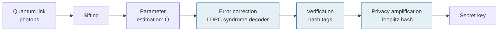
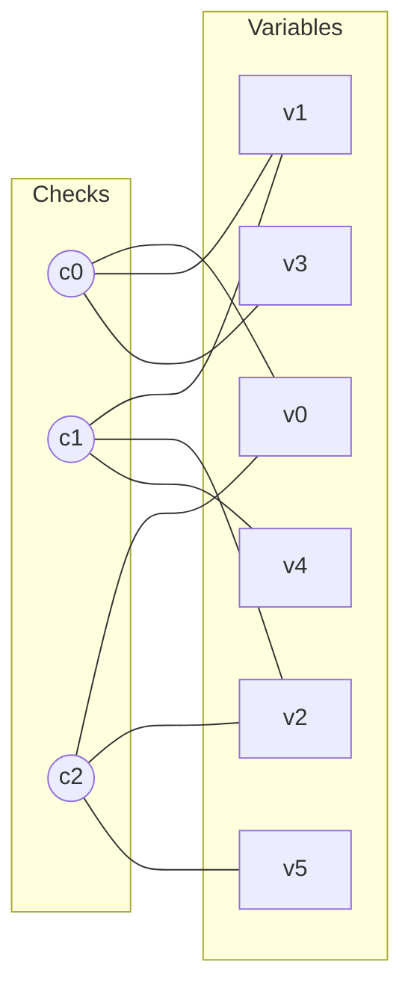
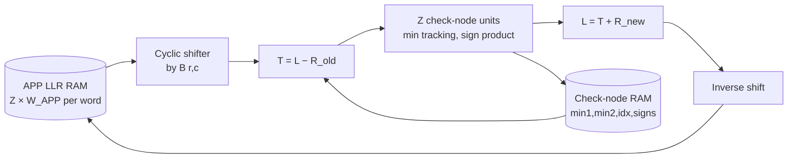

# 00 — Learning Guide

**Everything you need to understand this project: theory, maths and engineering, with worked examples.**

| Version | 0.1, 21 Sep 2026 |
|---|---|
| Audience | An ECE student who knows basic probability, digital logic and some Verilog, but not QKD or coding theory |
| How to use | Read Part I–III before writing models (M1–M2), and Part IV–V before writing RTL (M3–M4). Each chapter ends with self-check questions; answers are in [Appendix C](#appendix-c--self-check-answers). |

> Numbers in worked examples were computed for this guide. Where a result comes from a paper, the paper is named. When this guide and the [algorithm spec](05-algorithm-spec.md) differ, **the spec wins**.

## Contents

**Part I — Foundations**
1. [Probability essentials](#1-probability-essentials)
2. [Information theory](#2-information-theory)
3. [Linear algebra over GF(2) and binary polynomials](#3-linear-algebra-over-gf2-and-binary-polynomials)
4. [Just enough quantum physics](#4-just-enough-quantum-physics)

**Part II — Quantum key distribution**
5. [BB84 step by step](#5-bb84-step-by-step)
6. [Real-world imperfections and the decoy-state method](#6-real-world-imperfections-and-the-decoy-state-method)
7. [Security: what "secure" means and how much key survives](#7-security-what-secure-means-and-how-much-key-survives)

**Part III — Post-processing**
8. [Information reconciliation](#8-information-reconciliation)
9. [LDPC codes in depth](#9-ldpc-codes-in-depth)
10. [Error verification](#10-error-verification)
11. [Privacy amplification](#11-privacy-amplification)
12. [Authentication](#12-authentication)
13. [Putting it together: a worked key budget](#13-putting-it-together-a-worked-key-budget)

**Part IV — Hardware**
14. [FPGA fundamentals](#14-fpga-fundamentals)
15. [Fixed-point arithmetic](#15-fixed-point-arithmetic)
16. [LDPC decoder hardware](#16-ldpc-decoder-hardware)
17. [Hardware for Toeplitz hashing](#17-hardware-for-toeplitz-hashing)
18. [Zynq, AXI and hardware/software co-design](#18-zynq-axi-and-hardwaresoftware-co-design)

**Part V — Methodology**
19. [Verification methodology](#19-verification-methodology)
20. [Evaluation, statistics and fair comparison](#20-evaluation-statistics-and-fair-comparison)
21. [Research practice](#21-research-practice)

**Appendices:** [A Notation](#appendix-a--notation) · [B Numbers to remember](#appendix-b--numbers-to-remember) · [C Self-check answers](#appendix-c--self-check-answers) · [Reading list](#reading-list) · [Glossary](#glossary)

### The whole project in one picture



The shaded blocks are what you build in hardware. Everything in this guide exists to explain why those blocks look the way they do.

---

# Part I — Foundations

## 1. Probability essentials

### 1.1 Bernoulli and binomial variables
A **Bernoulli($p$)** variable is 1 with probability $p$ and 0 otherwise. Its mean is $p$ and its variance is $p(1-p)$.

In QKD, each sifted bit of Bob's is wrong independently with probability $Q$ (the QBER). The **number of errors** $E$ in a frame of $n$ bits is **binomial**:

$$E \sim \text{Bin}(n, Q),\qquad \mathbb{E}[E] = nQ,\qquad \sigma_E = \sqrt{nQ(1-Q)}.$$

> **Worked example.** $n = 65{,}536$ and $Q = 3\%$: mean 1,966 errors, standard deviation ≈ 43.7. So a frame almost never has more than about 2,100 errors (≈ 3σ). The decoder must fix *this* many errors in one frame.

### 1.2 Estimating a probability from samples
If you reveal $k$ random sifted bits and count $e$ mismatches, $\hat{Q} = e/k$. The **law of large numbers** says $\hat{Q} \to Q$ as $k$ grows. But how close is it for finite $k$?

### 1.3 Concentration: the Hoeffding bound
For $k$ independent samples bounded in $[0, 1]$:

$$\Pr\left[\hat{Q} - Q \le -\delta\right] \le e^{-2k\delta^2}\quad\Rightarrow\quad \delta = \sqrt{\frac{\ln(1/\varepsilon)}{2k}}$$

guarantees the true $Q$ is at most $\hat{Q} + \delta$, except with probability $\varepsilon$.

| $k$ (samples) | $\delta$ for $\varepsilon = 10^{-10}$ |
|---|---|
| $10^4$ | 3.39% |
| $10^5$ | 1.07% |
| $10^6$ | 0.339% |
| $10^7$ | 0.107% |

**Why this matters:** security proofs must assume the *worst* value consistent with the data ($\hat{Q} + \delta$). With small blocks, $\delta$ is large and eats the key. This is the **finite-key effect**, and it is why block size (and therefore memory) matters in this project (contribution C4).

### 1.4 The Poisson distribution
Lasers emit a random number of photons per pulse. For mean photon number $\mu$:

$$\Pr[n \text{ photons}] = e^{-\mu}\frac{\mu^n}{n!}.$$

| $\mu = 0.5$ | Probability |
|---|---|
| 0 photons | 0.6065 |
| 1 photon | 0.3033 |
| ≥ 2 photons | 0.0902 |

So about 22.9% of non-empty pulses carry two or more photons. That is a security problem (§4.5), solved by decoy states (§6).

### 1.5 Estimating a small error rate by simulation
If you simulate $F$ frames and see $k$ failures, $\widehat{\text{FER}} = k/F$. The relative standard error is about $1/\sqrt{k}$. **Rule of thumb:** collect at least 100 failures for ±10% relative standard error. To measure FER $= 10^{-3}$ you need about $10^5$ frames. That is why FER curves come from fast software models, not RTL simulation ([19](#19-verification-methodology)).

**Self-check 1**
1. For $n = 65{,}536$ and $Q = 5\%$, what is the expected number of errors per frame?
2. Why does the security proof use $\hat{Q} + \delta$ rather than $\hat{Q}$?
3. How many frames must you simulate to estimate FER ≈ $10^{-2}$ with about 100 failures?

---

## 2. Information theory

### 2.1 Entropy
The **entropy** of a random variable $X$ measures its unpredictability in bits:

$$H(X) = -\sum_x p(x)\log_2 p(x).$$

A fair coin has 1 bit. A coin that always lands heads has 0 bits.

### 2.2 Binary entropy — the most important function in this project

$$h(p) = -p\log_2 p - (1-p)\log_2(1-p)$$

Properties: $h(0) = h(1) = 0$; $h(0.5) = 1$; symmetric around 0.5; its slope is $h'(p) = \log_2\frac{1-p}{p}$, which is very steep near 0.

| $p$ | 1% | 2% | 3% | 5% | 8% | 10% | 11% | 25% |
|---|---|---|---|---|---|---|---|---|
| $h(p)$ | 0.0808 | 0.1414 | 0.1944 | 0.2864 | 0.4022 | 0.4690 | 0.4999 | 0.8113 |

Memorise the shape: even 1% errors cost 0.08 bits per bit, and at 11% half of every bit is "uncertainty".

### 2.3 Conditional entropy and mutual information
- $H(X \mid Y)$: uncertainty left about $X$ once you know $Y$.
- $I(X;Y) = H(X) - H(X\mid Y)$: information $Y$ gives about $X$.

For Alice's uniform bit $X$ and Bob's bit $Y = X \oplus E$ with $E \sim$ Bernoulli($Q$): $H(X\mid Y) = h(Q)$.

### 2.4 The binary symmetric channel (BSC)
The BSC flips each bit with probability $Q$. Its capacity is $C = 1 - h(Q)$ bits per use. At $Q = 11\%$, $C \approx 0.5$.

### 2.5 Source coding with side information (Slepian–Wolf) — the reconciliation limit
Bob already holds $Y$, which is correlated with Alice's $X$. How many bits must Alice send so Bob can recover $X$ exactly? Slepian and Wolf showed that $n\,H(X\mid Y) = n\,h(Q)$ bits suffice (asymptotically), and no fewer will do. Alice doesn't even need to know $Y$.

> **This is the benchmark for reconciliation.** Any real scheme leaks $\text{leak} \ge n\,h(Q)$. Its **efficiency** is
> $$f = \frac{\text{leak}}{n\,h(Q)} \ge 1.$$

Worked numbers for $n = 65{,}536$:

| $Q$ | Minimum leak $n h(Q)$ | Leak at $f = 1.1$ | Leak at $f = 1.2$ |
|---|---|---|---|
| 1% | 5,295 | 5,824 | 6,354 |
| 3% | 12,740 | 14,014 | 15,288 |
| 5% | 18,769 | 20,646 | 22,523 |

Every leaked bit is a bit the eavesdropper might know, and it is removed from the final key.

### 2.6 How a syndrome achieves this: binning
Put all $2^n$ possible strings into $2^m$ **bins** (cosets). Alice tells Bob only the bin number, which is $m$ bits. Bob searches the bin for the string closest to his $y$. If $m$ is a little more than $n h(Q)$, the closest string is almost always Alice's. A linear code's **syndrome** is exactly such a bin index ([§3.3](#33-codes-and-syndromes)).

### 2.7 Min-entropy — what privacy amplification needs
Shannon entropy measures average uncertainty. For secrecy, what matters is the **best guess**:

$$H_{min}(X) = -\log_2 \max_x \Pr[X = x].$$

*Example:* $X$ is 2 uniform bits, and Eve knows the first. Her best guess succeeds with probability 1/2, so $H_{min}(X\mid\text{Eve}) = 1$ bit. Privacy amplification can extract about as many secret bits as Eve's min-entropy ([§11](#11-privacy-amplification)). Security proofs use a "smooth" version that tolerates a tiny probability $\varepsilon$ of exceptions.

### 2.8 Log-likelihood ratios (LLRs)
Decoders don't work with probabilities directly. They use

$$L = \ln\frac{\Pr[x = 0 \mid \text{observation}]}{\Pr[x = 1 \mid \text{observation}]}.$$

$L > 0$ means "probably 0", and $|L|$ is the confidence. For a BSC with uniform prior, Bob's bit $y$ gives

$$L_{ch} = (1 - 2y)\ln\frac{1-Q}{Q}.$$

| $Q$ | $\ln\frac{1-Q}{Q}$ |
|---|---|
| 1% | 4.595 |
| 5% | 2.944 |
| 10% | 2.197 |

Lower QBER means each received bit is trusted more. LLRs add when evidence is independent, which is why decoders love them.

**Self-check 2**
1. Why is $f < 1$ impossible?
2. Compute the minimum leak for $n = 65{,}536$ at $Q = 2\%$.
3. Eve knows 3 of 8 uniform bits exactly. What is her min-entropy about the 8-bit string?

---

## 3. Linear algebra over GF(2) and binary polynomials

### 3.1 Arithmetic mod 2
GF(2) has two elements, 0 and 1. Addition is XOR ($1 \oplus 1 = 0$) and multiplication is AND. Subtraction equals addition. A **dot product** of bit vectors is the parity of the ANDed bits.

### 3.2 Matrices and vectors
$Hx$ over GF(2): each output bit is the XOR of the $x$ bits selected by the 1s in one row of $H$.

> **Worked example.**
> $$H = \begin{pmatrix}1&1&0&1&0&0\\0&1&1&0&1&0\\1&0&1&0&0&1\end{pmatrix},\quad x = (1,0,1,1,0,0)$$
> Row 0: $x_0 \oplus x_1 \oplus x_3 = 1\oplus0\oplus1 = 0$ · Row 1: $x_1\oplus x_2\oplus x_4 = 1$ · Row 2: $x_0\oplus x_2\oplus x_5 = 0$.
> So $s = Hx = (0, 1, 0)$.

### 3.3 Codes and syndromes
A **linear code** is the set of words $c$ with $Hc = 0$. For any word, $s = Hx$ is its **syndrome**. Words with the same syndrome form a **coset** (a bin).

The key trick in reconciliation: Bob has $y = x \oplus e$. Because everything is linear,

$$Hy \oplus s = H(x \oplus e) \oplus Hx = He.$$

Bob learns the **syndrome of the error pattern**. Decoding means finding the most likely (lowest-weight) $e$ with that syndrome.

> **Continuing the example.** Bob's bit 2 is flipped: $y = (1,0,0,1,0,0)$. $Hy = (0, 0, 1)$, so $Hy \oplus s = (0,1,1)$, which is exactly **column 2** of $H$. A single error at position 2 explains it. Bob flips $y_2$ and recovers $x$.

Real codes have $n = 65{,}536$ and thousands of errors, so exhaustive search is impossible. That is why we need iterative decoding ([§9](#9-ldpc-codes-in-depth)).

### 3.4 Rank and linear independence
Columns are **linearly independent** if no non-empty subset XORs to zero. The **rank** is the maximum number of independent columns. The algorithm spec's leakage rule ([05 §3.5](05-algorithm-spec.md#35-leakage-accounting)) needs the punctured columns of $H$ to be independent. You check this with Gaussian elimination over GF(2), which is just XORing rows.

### 3.5 Binary polynomials and convolution
A bit string $b_0 b_1 b_2\ldots$ can be written as a polynomial $b(z) = b_0 + b_1 z + b_2 z^2 + \cdots$. Multiplying polynomials over GF(2) is **convolution with XOR**:

> $(1 + z + z^3)(1 + z^2) = 1 + z^2 + z + z^3 + z^3 + z^5 = 1 + z + z^2 + z^5$ (the two $z^3$ terms cancel).

Toeplitz hashing ([§11](#11-privacy-amplification)) is exactly a window of such a product, so fast polynomial multiplication means fast privacy amplification.

### 3.6 Cyclic shifts and circulant matrices
Let $P$ be the $Z\times Z$ identity with columns shifted cyclically by one. In our convention ([05 §3.1](05-algorithm-spec.md#31-code-representation-qc-ldpc)), $P^k$ has ones at $(i, (i+k) \bmod Z)$. For $Z = 3$:

$$P^0 = I,\qquad P^1 = \begin{pmatrix}0&1&0\\0&0&1\\1&0&0\end{pmatrix}.$$

Multiplying a vector by $P^k$ **rotates** it by $k$. In hardware that is a barrel shifter, not a multiplier. QC-LDPC codes are built from these blocks, which is why they are hardware-friendly.

### 3.7 Extension fields GF(2^m) (brief)
Bit strings of length $m$ can form a field GF($2^m$), where multiplication is polynomial multiplication modulo an irreducible polynomial. You only need this if we choose a *polynomial hash* for verification ([§10.3](#103-alternative-polynomial-hashing)). In hardware, it is a carry-less multiplier followed by a reduction.

**Self-check 3**
1. Compute $Hx$ for the §3.2 matrix with $x = (0,1,1,0,1,1)$.
2. Why does Bob only need $Hy \oplus s$ to decode?
3. Multiply $(1+z)(1+z+z^2)$ over GF(2).

---

## 4. Just enough quantum physics

You do not need quantum mechanics to build the hardware. You need it to understand *why errors appear* and *why the eavesdropper's knowledge is bounded*.

### 4.1 Qubits and measurement
A qubit's state is $|\psi\rangle = a|0\rangle + b|1\rangle$ with $|a|^2 + |b|^2 = 1$. Measuring in the $\{|0\rangle, |1\rangle\}$ basis gives 0 with probability $|a|^2$ and 1 with probability $|b|^2$. After measurement, the state *becomes* the outcome. The original is gone.

### 4.2 Two bases (photon polarisation)

| Basis | States | Physical polarisation |
|---|---|---|
| Z (rectilinear) | $\lvert0\rangle$, $\lvert1\rangle$ | Horizontal, vertical |
| X (diagonal) | $\lvert+\rangle = \tfrac{1}{\sqrt2}(\lvert0\rangle+\lvert1\rangle)$, $\lvert-\rangle = \tfrac{1}{\sqrt2}(\lvert0\rangle-\lvert1\rangle)$ | +45°, −45° |

Measuring $|+\rangle$ in the Z basis gives 0 or 1 with probability ½ each, a completely random result. Measuring in the *matching* basis gives the right answer with certainty.

### 4.3 No-cloning
An unknown quantum state cannot be copied perfectly. Eve can't copy each photon, keep one and forward the other. She has to measure (or otherwise disturb) the original.

### 4.4 Why eavesdropping causes errors: intercept–resend
Eve measures each photon in a random basis and resends what she saw.
- Half the time she picks the right basis: she learns the bit and resends the correct state, so no error appears.
- Half the time she picks the wrong basis: her result is random, and she resends a state in the wrong basis. When Bob measures in the correct basis, he gets a random bit, which is wrong half the time.

Result: **QBER = ½ × ½ = 25%**, and Eve learns 50% of the bits. Errors are the fingerprint of eavesdropping, so Alice and Bob estimate the QBER and **abort** if it is too high. Below the threshold, they remove Eve's (bounded) knowledge with privacy amplification.

### 4.5 Weak laser pulses and the photon-number-splitting attack
Practical systems use attenuated laser pulses, not true single photons. Photon number is Poisson($\mu$) ([§1.4](#14-the-poisson-distribution)). When a pulse has ≥ 2 photons, Eve can split one off, store it, and measure it after the bases are announced. She learns the bit **without causing errors**. This is the photon-number-splitting (PNS) attack. The decoy-state method ([§6.3](#63-the-decoy-state-idea)) defeats it.

### 4.6 Loss and detectors
- **Fibre loss:** about 0.2 dB/km at 1550 nm. Transmittance $T = 10^{-\alpha L/10}$.

| Distance | Loss | $T$ |
|---|---|---|
| 25 km | 5 dB | 0.316 |
| 50 km | 10 dB | 0.1 |
| 100 km | 20 dB | 0.01 |

- **Detectors:** single-photon avalanche diodes (SPADs) or superconducting nanowire detectors (SNSPDs). Key parameters are efficiency $\eta_{det}$, **dark counts** (clicks with no photon), dead time and timing jitter. Dark counts produce random bits, which is why QBER rises at long distance.

**Self-check 4**
1. Why does measuring in the wrong basis produce a random result?
2. Derive the 25% QBER of intercept–resend.
3. Why is a two-photon pulse dangerous, even though it causes no errors?

---

# Part II — Quantum key distribution

## 5. BB84 step by step

### 5.1 The protocol
1. Alice picks a random bit and a random basis (Z or X) for each pulse, and sends the corresponding state.
2. Bob measures each pulse in a random basis.
3. **Sifting:** over the public channel, they announce *bases* (not bits) and keep only the positions where the bases match.
4. **Parameter estimation:** they reveal a random sample of sifted bits to estimate the QBER. Revealed bits are discarded.
5. **Post-processing:** error correction → verification → privacy amplification. These are the stages this project builds.

### 5.2 A toy run (10 pulses, one channel error)

| Position | 1 | 2 | 3 | 4 | 5 | 6 | 7 | 8 | 9 | 10 |
|---|---|---|---|---|---|---|---|---|---|---|
| Alice bit | 0 | 1 | 1 | 0 | 1 | 0 | 0 | 1 | 1 | 0 |
| Alice basis | Z | X | X | Z | Z | X | Z | X | Z | X |
| Bob basis | Z | Z | X | X | Z | X | X | X | Z | Z |
| Bases match? | ✓ | ✗ | ✓ | ✗ | ✓ | ✓ | ✗ | ✓ | ✓ | ✗ |
| Bob result | 0 | (rand) | 1 | (rand) | 1 | 0 | (rand) | **0** | 1 | (rand) |

- Sifted key: Alice has `0 1 1 0 1 1` and Bob has `0 1 1 0 0 1`. There is one error (position 8), so QBER = 1/6 in this toy example.
- In a real system, $10^6$–$10^9$ sifted bits accumulate before post-processing.

### 5.3 Sifting efficiency
With equal basis probabilities, half the bits survive sifting ($q = \tfrac12$). **Efficient BB84** chooses one basis (say X) with high probability $p_X$ for the key and uses the other mostly for testing. Sifting efficiency becomes $p_X^2 + p_Z^2$. Lim et al. (2014) use this asymmetric setting: the key comes from the X basis, and phase errors are estimated from Z.

**Self-check 5**
1. Why may Alice and Bob announce bases publicly without harming security?
2. In §5.2, which positions would a 50% sample for parameter estimation reveal, and what happens to them?
3. What is the sifting efficiency with $p_X = 0.9$?

---

## 6. Real-world imperfections and the decoy-state method

### 6.1 Gain and QBER model
For a pulse of mean photon number $\mu$ and total transmittance $\eta = \eta_{Bob}\eta_{det}10^{-\alpha L/10}$ (Ma et al., 2005):

$$Q_\mu = Y_0 + 1 - e^{-\eta\mu}\qquad\text{(probability Bob clicks)}$$

$$E_\mu Q_\mu = \tfrac12 Y_0 + e_d(1 - e^{-\eta\mu})\qquad\text{(erroneous clicks)}$$

- $Y_0$: dark-count probability per pulse. These clicks are random, so half are errors.
- $e_d$: probability that a real photon lands in the wrong detector (misalignment).

> **Worked example** (illustrative parameters: $\eta_{Bob}\eta_{det} = 0.2$, $\mu = 0.5$, $Y_0 = 10^{-6}$, $e_d = 1\%$):
>
> | Distance | $\eta$ | Gain $Q_\mu$ | QBER $E_\mu$ |
> |---|---|---|---|
> | 50 km | 0.02 | 9.95 × 10⁻³ | 1.01% |
> | 150 km | 2 × 10⁻⁴ | 1.01 × 10⁻⁴ | 1.49% |
> | 250 km | 2 × 10⁻⁶ | 2.0 × 10⁻⁶ | **25.5%** |
>
> At long distance, real signal clicks fall to the level of dark counts, the QBER shoots up, and the key rate collapses.

### 6.2 What the eavesdropper can exploit
Without extra measures, Eve could claim all multi-photon pulses (PNS attack) and block single photons to hide her presence. Alice and Bob need to know how many clicks came from **single-photon** pulses, because only those are guaranteed secure.

### 6.3 The decoy-state idea
Alice randomly varies the intensity: a *signal* $\mu_1$ plus one or two *decoys* ($\mu_2$, and $\mu_3 \approx 0$). Eve sees only photon numbers, not which intensity a pulse came from. So the **yield** $Y_n$ (click probability given $n$ photons) and error $e_n$ must be the *same* for every intensity. Measuring $Q_\mu$ and $E_\mu$ for several $\mu$ gives equations whose solution bounds $Y_1$ (single-photon yield) and $e_1$ (single-photon error rate).

### 6.4 Asymptotic key rate (GLLP with decoys)

$$R \ge q\left\{-Q_\mu f\,h(E_\mu) + Q_1[1 - h(e_1)]\right\},\qquad Q_1 = Y_1\mu e^{-\mu}$$

Read it as: **(secret bits from single-photon pulses) − (bits leaked by error correction)**. Note the $f$ in the first term. Every 0.1 of reconciliation inefficiency is paid on *all* signal clicks, which is why your decoder's efficiency directly lowers the key rate.

**Self-check 6**
1. Why do dark counts contribute errors with probability ½?
2. Why can't Eve treat decoy pulses differently from signal pulses?
3. In the GLLP formula, which term does this project's hardware influence?

---

## 7. Security: what "secure" means and how much key survives

### 7.1 Composable ε-security
A key is **ε-secure** if, in every possible use, it behaves like a perfect key (uniform and unknown to Eve) except with probability at most ε. Two parts:

| Parameter | Meaning |
|---|---|
| $\varepsilon_{cor}$ | Probability that Alice's and Bob's final keys **differ** without anyone noticing |
| $\varepsilon_{sec}$ | Probability that the key is **not** secret (distinguishable from ideal) |

The project defaults are $\varepsilon_{sec} = 10^{-9}$ and $\varepsilon_{cor} = 10^{-12}$ ([ADR-004](decisions/ADR-004-security-parameters.md)).

### 7.2 Bit errors vs phase errors
Eve's information about the key is not bounded by the bit error rate directly. It is bounded by the **phase error rate** $e_{ph}$: the error rate you *would* have seen in the other basis. In BB84 the two bases play symmetric roles, so the phase error rate is estimated from the error rate measured in the other basis.

### 7.3 Shor–Preskill and the effect of $f$
With ideal single photons, infinite keys and perfect error correction:

$$r = 1 - h(e_{bit}) - h(e_{ph}) \approx 1 - 2h(Q).$$

This reaches zero at $Q \approx 11.0\%$. With real error correction of efficiency $f$:

$$r \approx 1 - h(Q) - f\,h(Q).$$

| $f$ | $r$ at $Q$ = 2% | 3% | 5% | 8% | Key stops at |
|---|---|---|---|---|---|
| 1.0 | 0.717 | 0.611 | 0.427 | 0.196 | 11.0% |
| 1.1 | 0.703 | 0.592 | 0.399 | 0.155 | 10.2% |
| 1.2 | 0.689 | 0.572 | 0.370 | 0.115 | 9.5% |

At $Q = 5\%$, going from $f = 1.0$ to $1.1$ loses **6.7%** of the key, and $1.2$ loses **13.4%**.

### 7.4 Finite-key analysis
Real blocks are finite, so every estimated quantity carries a statistical margin ([§1.3](#13-concentration-the-hoeffding-bound)). The Lim et al. (2014) key length:

$$\ell = \left\lfloor s_{X,0} + s_{X,1}(1 - h(\phi_X)) - \lambda_{EC} - 6\log_2\tfrac{21}{\varepsilon_{sec}} - \log_2\tfrac{2}{\varepsilon_{cor}}\right\rfloor$$

- $s_{X,0}, s_{X,1}$: guaranteed (lower-bounded) numbers of vacuum and single-photon events in the key basis.
- $\phi_X$: guaranteed (upper-bounded) phase error rate of those single photons.
- $\lambda_{EC}$: bits leaked by **your** error correction and verification.
- The last two terms are fixed costs: ≈ 205.7 + 40.9 bits with our ε values.

As blocks grow, the margins inside $s_{X,1}$ and $\phi_X$ shrink like $1/\sqrt{\text{sample size}}$. Small blocks can yield *zero* key at distances where large blocks still work.

> **The project's central trade-off:** bigger blocks → more key (smaller finite-key penalty) → more memory and slower hashing. On a small FPGA this is a real engineering decision, not a footnote. That is contribution C4.

**Self-check 7**
1. What goes wrong if $\varepsilon_{cor}$ is too large?
2. Why is $f = 1.2$ worse at high QBER than at low QBER, in *relative* terms?
3. Why does the finite-key penalty shrink with block size?

---

# Part III — Post-processing

## 8. Information reconciliation

### 8.1 The task
Alice has $x_A$ and Bob has $y$, which differs from $x_A$ in about $nQ$ positions. They talk over a **public** channel until Bob holds $\hat{x} = x_A$. Everything they say is known to Eve and counted as leakage.

| Choice | Options | This project |
|---|---|---|
| Direction | *Direct* (Bob corrects to Alice) or *reverse* | Direct |
| Interaction | *One-way* (Alice sends once) or *interactive* (many rounds) | One-way |

### 8.2 Cascade: the classic interactive protocol
1. Shuffle the key with a shared permutation. Split it into blocks of size $k_1 \approx 0.73/Q$.
2. Compare the **parity** of each block. If the parities differ, the block has an odd number of errors.
3. **BINARY search:** split the block in half, compare the parity of one half, recurse into the half that disagrees. This finds one error with $\lceil\log_2 k\rceil$ extra parities.
4. Later passes use new shuffles and bigger blocks. Fixing an error in pass 2 can reveal another error in a pass-1 block that now has odd parity, so errors are fixed in a "cascade".

*Example:* 8-bit block, error at bit 5. Compare parities of bits 0–3: equal, so the error is in 4–7. Compare 4–5: differ, so it's in 4–5. Compare bit 4: equal, so bit 5 is wrong. That took 3 parities ($\log_2 8$), and every one of them counts as leakage.

**Why not Cascade in hardware:** it needs many round trips over the network, and each step depends on the previous answer. That is sequential and latency-bound. It stays as a **software baseline** ([ADR-003](decisions/ADR-003-ldpc-over-cascade-and-polar.md)).

### 8.3 One-way syndrome reconciliation
Alice sends $s = Hx_A$ ($m$ bits). Bob finds $\hat{x}$ close to $y$ with $H\hat{x} = s$ ([§3.3](#33-codes-and-syndromes)). It takes a single message, Bob's work is local, and decoding parallelises well. The leakage is $m$ bits (or $m - p$ with puncturing, [§9.11](#911-rate-adaptation-puncturing-and-shortening)), so the efficiency is $f = m/(n\,h(Q))$ for an unmodified code.

**Self-check 8**
1. How many parities does BINARY need for a 64-bit block?
2. Why is Cascade's round-trip count a problem for high-rate systems?
3. A code has $m = 20{,}000$ checks and $n = 65{,}536$. What is $f$ at $Q = 5\%$?

---

## 9. LDPC codes in depth

### 9.1 Definition and Tanner graph
A **low-density parity-check (LDPC)** code has a *sparse* $H$: only a few ones per row and column. Draw it as a bipartite **Tanner graph**:
- **Variable nodes** (one per bit, $n$ of them)
- **Check nodes** (one per row, $m$ of them)
- An **edge** wherever $H_{ij} = 1$


*(This is the Tanner graph of the §3.2 matrix.)*

### 9.2 Degrees and rate
- A variable node's **degree** $d_v$ is its column weight. A check node's degree $d_c$ is its row weight.
- **Regular** $(d_v, d_c)$ codes have design rate $R = 1 - d_v/d_c$. Example: (3, 6) gives $R = \tfrac12$.
- **Irregular** codes mix degrees, described by edge-perspective polynomials $\lambda(x) = \sum_i \lambda_i x^{i-1}$ and $\rho(x) = \sum_i \rho_i x^{i-1}$. Here $\lambda_i$ is the fraction of *edges* attached to degree-$i$ variables. The design rate is $R = 1 - \int_0^1\rho / \int_0^1\lambda$. Good irregular codes get much closer to the Shannon limit than regular ones.

### 9.3 Cycles and girth
A **cycle** is a closed path in the Tanner graph. The **girth** is the length of the shortest one. Short cycles (length 4) make the decoder's messages reinforce themselves and hurt performance. Constructions aim for girth ≥ 6, ideally 8.

### 9.4 Quasi-cyclic (QC) LDPC codes
Specify a small **base matrix** $B$ and a lifting size $Z$. Each entry becomes a $Z\times Z$ block: $-1$ becomes an all-zero block, and $k$ becomes the circulant $P^k$ ([§3.6](#36-cyclic-shifts-and-circulant-matrices)).

> **Example.** $Z = 3$, $B = \begin{pmatrix}0 & 1 & -1 & 2\\ 2 & -1 & 0 & 1\end{pmatrix}$ expands to a $6 \times 12$ matrix $H$:
> $$H = \begin{pmatrix} P^0 & P^1 & 0 & P^2 \\ P^2 & 0 & P^0 & P^1 \end{pmatrix}$$
> Check $3r + i$ connects to variable $3c + ((i + B[r,c]) \bmod 3)$. For instance, check 1 (block row 0, $i = 1$) connects to variables 1, 5 and 9.

**Why hardware loves QC codes:**
- You store only $B$ (a few kilobits), not $H$.
- The $Z$ checks of a block row can be processed **in parallel**. Each variable appears at most once per block row, so they never conflict.
- Routing data between memories is a **cyclic rotation**, done by a barrel shifter.

Our working design: $Z = 128$, $n_b = 512$, so $n = 65{,}536$.

### 9.5 Constructing good codes
- **Protographs:** a small base graph whose degree structure is optimised, then *lifted* by $Z$.
- **PEG (progressive edge growth):** adds edges one at a time, each placed to maximise the local girth (Hu, Eleftheriou & Arnold, 2005).
- **Circulant shift selection:** choose the shifts $k$ to avoid short cycles.

### 9.6 Belief propagation (sum-product)
Bits and checks exchange LLR messages until they agree.

**Variable → check.** The message from variable $j$ to check $i$ is everything $j$ knows *except* what $i$ told it:

$$T_{j\to i} = L_{ch,j} + \sum_{i' \in \mathcal{N}(j)\setminus i} R_{i'\to j}.$$

**Check → variable.** For independent bits with $\Pr[b_k = 1] = p_k$, the parity is odd with probability $\tfrac12\left(1 - \prod_k(1 - 2p_k)\right)$. Since $1 - 2p_k = \tanh(L_k/2)$, the check tells bit $j$:

$$R_{i\to j} = (-1)^{s_i}\;2\tanh^{-1}\!\Big(\prod_{j' \in \mathcal{N}(i)\setminus j}\tanh\frac{T_{j'\to i}}{2}\Big).$$

The factor $(-1)^{s_i}$ is the **syndrome twist**. With a normal code the parity must be even; in syndrome decoding it must equal $s_i$.

**Decision.** The a-posteriori LLR is $L_j = L_{ch,j} + \sum_{i \in \mathcal{N}(j)} R_{i\to j}$, and $\hat{x}_j = 1$ if $L_j < 0$. Stop when $H\hat{x} = s$.

### 9.7 Min-sum and its corrections
The $\tanh$ rule is expensive in hardware. The smallest input magnitude dominates the product, so:

$$R_{i\to j} \approx (-1)^{s_i}\prod_{j'\neq j}\operatorname{sign}(T_{j'})\cdot\min_{j'\neq j}|T_{j'}|.$$

This is **min-sum**: only comparisons and XORs of signs. It *overestimates* the magnitude, so two corrections are used:
- **Normalized min-sum:** multiply by $\alpha \approx 0.75$–$0.85$.
- **Offset min-sum:** subtract $\beta$, clamping at 0.

> **Worked example.** A check has three other inputs with LLRs +1.0, +2.0, +3.0 (and $s_i = 0$).
> - Exact: $\tanh(0.5)\tanh(1.0)\tanh(1.5) = 0.3186$, so $R = 2\tanh^{-1}(0.3186) = 0.660$.
> - Min-sum: $R = 1.0$, an overestimate.
> - Normalized ($\alpha = 0.75$): $R = 0.75$, much closer.

**Implementation trick:** a check only needs its **two smallest** magnitudes (min1, min2), the **index** of the smallest, and the **sign product**. Every outgoing message is min1, except the one to the minimum's own input, which gets min2. That makes check-node storage tiny ([§16.4](#164-compressed-check-node-storage)).

### 9.8 Schedules: flooding vs layered
- **Flooding:** all checks update, then all variables update. It is simple and fully parallel, but slow to converge.
- **Layered** (Hocevar, 2004): process checks one group (layer) at a time, and update the APP values *immediately*, so later layers use fresher information. It converges in roughly **half the iterations** and needs no separate variable-node phase:

$$T_j = L_j - R_{ij}^{old},\quad R_{ij}^{new} = \text{CNU}(\{T\}),\quad L_j = T_j + R_{ij}^{new}.$$

In a QC code, a natural layer is one block row. This is exactly the loop in [05 §3.6](05-algorithm-spec.md#36-decoding-layered-normalized-min-sum-l2-bit-true).

### 9.9 Stopping and failure modes
- **Early termination:** check $H\hat{x} = s$ after each iteration and stop when it holds. The *average* iteration count sets the throughput.
- **Decoding failure:** $I_{max}$ is reached without satisfying the syndrome. The frame is discarded.
- **Undetected error:** the decoder converges to a *different* word with the same syndrome. This is rare, but possible, so we verify with hash tags ([§10](#10-error-verification)).
- **Error floor:** at low noise, the FER stops falling steeply because of small harmful subgraphs (trapping sets). Good construction pushes the floor below the operating FER.

### 9.10 Density evolution and the finite-length gap
**Density evolution** tracks the *distribution* of messages over iterations for an infinitely long code with a given $(\lambda, \rho)$. It gives a **threshold** $Q^*$: below $Q^*$ decoding succeeds with probability approaching 1. Comparing $Q^*$ with the Shannon limit (where $1 - R = h(Q)$) tells you how good a degree distribution is before you build any matrix.

Real codes are finite, so they need some margin below $Q^*$. That margin shrinks as $n$ grows, which is why $n = 65{,}536$ reaches better $f$ than the ≈ 8k-bit 5G codes. On FPGA, $n$ is limited by BRAM ([§16.5](#165-memory-and-resource-estimates)).

### 9.11 Rate adaptation: puncturing and shortening
The required code rate $R = 1 - f\,h(Q)$ changes with QBER:

| $Q$ | 1% | 2% | 3% | 5% | 8% | 10% |
|---|---|---|---|---|---|---|
| $R$ needed ($f = 1.1$) | 0.911 | 0.844 | 0.786 | 0.685 | 0.558 | 0.484 |

Rather than storing many codes, adapt one **mother code** of rate $R_0$ (Elkouss et al., 2011):
- **Puncture** $p$ positions: fill them with private random bits that Bob knows nothing about (LLR = 0). This **raises** the rate.
- **Shorten** $s$ positions: fix them to values Bob knows (LLR = ±max). This **lowers** the rate.

$$R = \frac{R_0 - \sigma}{1 - \pi - \sigma},\qquad \pi = p/n,\ \sigma = s/n.$$

> **Worked example** ($R_0 = 0.7$, $n = 65{,}536$):
> - Target $R = 0.8$ (low QBER): puncture only, $\pi = 1 - R_0/R = 0.125$, so $p = 8{,}192$.
> - Target $R = 0.5$ (high QBER): shorten only, $\sigma = (R_0 - R)/(1 - R) = 0.4$, so $s = 26{,}214$. That's a lot of wasted positions, and efficiency degrades with heavy shortening.
>
> **Lesson:** one mother code covers a limited rate band well. Covering 0.48–0.91 may need a well-chosen $R_0$ plus combined puncturing and shortening, or two mother codes. This is decided in [06](06-ldpc-code-design.md).

**Leakage with puncturing:** the syndrome reveals $m$ bits, but $p$ of them are "absorbed" by the random fill bits, provided the punctured columns of $H$ are linearly independent. So leak $= m - p$ ([05 §3.5](05-algorithm-spec.md#35-leakage-accounting)).

**Blind reconciliation** (Martinez-Mateo et al., 2012; Kiktenko et al., 2017): start with high puncturing, and if decoding fails, reveal some punctured bits and retry. This removes the need for a precise QBER estimate. It is a possible extension.

**Self-check 9**
1. What is the design rate of a regular (4, 8) code?
2. In the §9.4 example, which variables does check 4 connect to?
3. Why does min-sum overestimate check-message magnitude?
4. Compute the puncturing needed to turn $R_0 = 0.7$ into $R = 0.75$.

---

## 10. Error verification

### 10.1 Why verify?
The decoder can stop at a word that satisfies $H\hat{x} = s$ but differs from $x_A$ (an undetected error, [§9.9](#99-stopping-and-failure-modes)). If Alice and Bob then run privacy amplification, they get *different* keys. Verification catches this with high probability.

### 10.2 Universal hashing
A family of hash functions $\{h_v\}$ is **2-universal** if, for any two *different* inputs $x \neq x'$,

$$\Pr_v\left[h_v(x) = h_v(x')\right] \le 2^{-t}$$

for a randomly chosen key (seed) $v$ and $t$-bit outputs. The **Toeplitz family** ([§11.3](#113-toeplitz-hashing)) is 2-universal. In our protocol:
1. Alice picks a random seed $v$ *after* Bob has decoded, so the seed is independent of the errors.
2. Both compute a 64-bit tag. Alice sends hers.
3. If the tags differ, the frame is discarded.

If $\hat{x}_{key} \neq x_A$, the tags match with probability at most $2^{-64}$. Over $K$ frames (union bound), $\varepsilon_{cor} \le K\cdot 2^{-64}$.

> **Worked example.** A block of 10⁷ bits is about 153 frames, so $\varepsilon_{cor} \le 153 \times 2^{-64} \approx 8.3\times10^{-18}$. That is far below our target $10^{-12}$. The cost is 64 leaked bits per frame (≈ 0.1% of 65,536).

### 10.3 Alternative: polynomial hashing
Split the key into $d$ words of 64 bits, treat them as coefficients, and evaluate the polynomial at a random point $r \in$ GF($2^{64}$). Two different messages collide only if $r$ is a root of their difference polynomial, which has at most $d$ roots. So $\Pr[\text{collision}] \le d/2^{64}$. For $d = 1{,}024$ words that is $2^{-54}$ per frame. It needs only a 64-bit seed and one GF($2^{64}$) multiplier. We will compare it with Toeplitz in an ADR.

**Self-check 10**
1. Why must the verification seed be chosen *after* decoding?
2. Why does the tag length count as leakage?

---

## 11. Privacy amplification

### 11.1 The idea
After reconciliation, Alice and Bob share $X$ ($N$ bits), but Eve has some information: partly from the quantum stage, and partly from the $\lambda_{EC}$ leaked bits. Privacy amplification **compresses** $X$ into a shorter key $k$ ($\ell$ bits) that Eve knows essentially nothing about.

### 11.2 The leftover hash lemma (informal)
If Eve's (smooth) min-entropy about $X$ is at least $H$ bits, then hashing $X$ with a *randomly chosen* 2-universal function to

$$\ell \approx H - 2\log_2(1/\varepsilon)$$

bits gives a key that is ε-close to uniform and independent of Eve's information, **even though Eve learns which hash function was used**. The finite-key formula ([§7.4](#74-finite-key-analysis)) is essentially a careful lower bound on $H$ minus these penalties.

### 11.3 Toeplitz hashing
A **Toeplitz matrix** is constant along each diagonal. In our convention ([05 §5](05-algorithm-spec.md#5-privacy-amplification)), entry $(i, j)$ is $\tau_{i+j}$, so the whole $\ell \times N$ matrix is defined by a seed of $N + \ell - 1$ bits:

$$k_i = \bigoplus_{j=0}^{N-1}\tau_{i+j}\,X_j,\qquad i = 0,\dots,\ell-1.$$

> **Worked example.** $N = 4$, $\ell = 2$, seed $\tau = (1,0,1,1,0)$, input $X = (1,1,0,1)$.
> - Row 0 = $(\tau_0..\tau_3) = (1,0,1,1)$: $k_0 = 1\cdot1 \oplus 0\cdot1 \oplus 1\cdot0 \oplus 1\cdot1 = 0$
> - Row 1 = $(\tau_1..\tau_4) = (0,1,1,0)$: $k_1 = 0 \oplus 1 \oplus 0 \oplus 0 = 1$
>
> Output $k = (0, 1)$. Put this in your unit tests.

### 11.4 The polynomial view
Each output bit is a sum of products $\tau_{i+j}X_j$, which is the coefficient pattern of polynomial multiplication. The $\ell$ output bits are a **window** of the GF(2) product of $\tau(z)$ and the reversed $X(z)$ ([§3.5](#35-binary-polynomials-and-convolution)). So:

| Method | Cost | Notes |
|---|---|---|
| Direct (row by row) | $N\cdot\ell$ AND-XOR operations | $5\times10^{11}$ for $N = 10^6$, $\ell = N/2$ |
| Karatsuba | about $N^{1.585}$ | Recursive split-multiply |
| FFT / NTT | about $N\log N$ | Compute the *integer* convolution with a number-theoretic transform modulo a prime $> N$, then take each coefficient mod 2 |

That is why large-block PA papers (Li Q. 2019; Yan et al. 2021) use FFT/NTT or modular-arithmetic hashing.

### 11.5 Modified Toeplitz
$H = [\,I_\ell \mid T'\,]$, with $T'$ an $\ell\times(N-\ell)$ Toeplitz matrix, needs only $N - 1$ seed bits and remains suitable for privacy amplification (Hayashi & Tsurumaru, 2016). It is an optional mode.

### 11.6 Seeds
Seeds are **public** but must be **random** and chosen **after** the data they hash is fixed. In simulation they come from a seeded PRNG so runs are reproducible ([04 §6](04-system-model.md#6-randomness)).

**Self-check 11**
1. Recompute the §11.3 example with $X = (0,1,1,1)$.
2. Why is it safe for Eve to know the Toeplitz seed?
3. For $N = 10^6$ and $\ell = 5\times10^5$, how many AND-XOR operations does the direct method need?

---

## 12. Authentication

The public channel must be **authenticated**: Eve may read it but not alter it. Otherwise she could impersonate Bob to Alice and vice versa (man-in-the-middle). The standard method is **Wegman–Carter**: tag each message with a universal hash keyed by a short pre-shared secret, and encrypt the tag with a one-time pad. Each round consumes a little key, which QKD replenishes, so QKD is really a *key-growing* protocol. This project assumes the channel is authenticated and treats its key cost as a small constant ([04 §7](04-system-model.md#7-authentication)).

---

## 13. Putting it together: a worked key budget

A simplified example (ideal single-photon source, phase error ≈ bit error, finite-key terms ignored), to see how each stage costs key:

| Step | Quantity | Value |
|---|---|---|
| Sifted key rate | — | 20 Mbps |
| QBER | $Q$ | 3% |
| Privacy cost | $h(Q)$ | 0.1944 |
| Reconciliation cost ($f = 1.1$) | $f\,h(Q)$ | 0.2138 |
| Verification cost | $64/65{,}536$ | 0.0010 |
| Secret fraction before losses | $1 - h - fh - 0.001$ | 0.5908 |
| Frame losses (FER = 1%) | × 0.99 | 0.5849 |
| **Secret key rate** | × 20 Mbps | **≈ 11.7 Mbps** |

The hardware must decode **all 20 Mbps of sifted key**, not 11.7. With finite-key penalties and multi-photon pulses, real numbers are lower. You will compute them properly in experiment E5.

---

# Part IV — Hardware

## 14. FPGA fundamentals

### 14.1 What's inside a 7-series FPGA

| Resource | What it is | Use in this project |
|---|---|---|
| **LUT6** | A 64-entry truth table; implements *any* function of 6 inputs (or two of 5) | Comparators, XOR trees, muxes |
| **Flip-flop (FF)** | 1-bit register | Pipeline stages, state |
| **Slice** | 4 LUT6 + 8 FF + a carry chain (7-series) | The basic logic tile |
| **Carry chain (CARRY4)** | Fast dedicated adder logic | LLR additions and subtractions |
| **Block RAM (BRAM36)** | 36 Kb of memory; configurable aspect ratio, e.g. 512 × 72 in simple dual-port mode | APP LLRs, check-node state, frames |
| **DSP48E1** | 25 × 18 multiplier + 48-bit accumulator | NTT-based PA (if used); mostly idle in the decoder |
| **Routing** | Programmable wires between everything | Often what limits Fmax |

The **Zynq-7020** has 53,200 LUTs, 106,400 FFs, 140 BRAM36 (5,040 Kb) and 220 DSPs in its PL, plus a dual-core ARM Cortex-A9 **PS** with a DDR3 memory controller.

### 14.2 Timing: setup, slack and Fmax
In a synchronous circuit, data must travel from one register, through logic and routing, to the next register **within one clock period** (minus setup time).
- **Slack** = required arrival time − actual arrival time. Positive means OK.
- **WNS** (worst negative slack) is the slack of the worst path. **WNS ≥ 0 means timing is met.**
- **Critical path:** the path with the smallest slack. Approximately, $F_{max} \approx 1/(T_{clk} - \text{WNS})$.
- **Hold** checks are the opposite: data must not change *too soon* after the clock edge. The tool usually fixes these.

### 14.3 Pipelining, latency and throughput
Inserting registers into a long path splits it into shorter stages. Fmax goes up and latency (in cycles) goes up, but **throughput** (results per second) improves. Hazards appear when a later operation needs a result that is still in the pipeline. In a layered decoder this happens when consecutive layers touch the same variables ([§16.3](#163-the-layered-pipeline-and-its-hazard)).

### 14.4 Parallelism vs area
Doing $P$ operations per cycle costs about $P\times$ the logic. The design question is always which $P$ meets the throughput target within the LUT, BRAM and power budget.

### 14.5 Power
- **Static power:** leakage, roughly constant for a given device and temperature.
- **Dynamic power:** $P_{dyn} \approx \alpha\,C\,V^2 f$, where $\alpha$ is the switching activity, $C$ the capacitance, $V$ the voltage and $f$ the clock frequency.

Vivado's estimate is only as good as its $\alpha$. **Vectorless** estimates guess the activity. **SAIF** files record the real activity from simulation and give much better estimates ([19.6](#196-power-estimation-with-saif)).

**Self-check 14**
1. A design is constrained at 8.0 ns and reports WNS = +0.6 ns. Estimate Fmax.
2. Why does adding pipeline registers raise throughput but not reduce latency?
3. Which FPGA resource will limit the LDPC frame length?

---

## 15. Fixed-point arithmetic

### 15.1 Two's complement and ranges
A $W$-bit signed integer spans $[-2^{W-1}, 2^{W-1}-1]$. We use the **symmetric** range $[-(2^{W-1}-1), +(2^{W-1}-1)]$, so negating never overflows ([05 §2](05-algorithm-spec.md#2-conventions)).

| Width | Symmetric max |
|---|---|
| 5 bits | ±15 |
| 6 bits | ±31 |
| 8 bits | ±127 |

### 15.2 Scaling real values
An LLR $L$ is stored as the integer $\text{round}(L/\Delta)$, where $\Delta$ is the quantisation step. With $\Delta = 0.25$:

| $Q$ | $\ln\frac{1-Q}{Q}$ | $/\Delta$ | Stored $A$ (5-bit, max 15) |
|---|---|---|---|
| 1% | 4.595 | 18.38 | **15** (saturated) |
| 5% | 2.944 | 11.78 | 12 |
| 10% | 2.197 | 8.79 | 9 |

### 15.3 Saturation vs wrap-around
If a sum exceeds the range, plain binary arithmetic **wraps**: +127 + 1 becomes −128. That flips a confident "0" into a confident "1", which is catastrophic for a decoder. So every LLR operation **saturates** (clamps) instead. Saturation logic costs a few LUTs per adder, and it is non-negotiable.

### 15.4 Multiplying by α with shifts
$\alpha = 0.75 = \tfrac12 + \tfrac14$, so $\alpha v \approx (v \gg 1) + (v \gg 2)$. There's no multiplier, just two wires and an adder.

| $v$ | Exact $0.75v$ | $(v\gg1)+(v\gg2)$ |
|---|---|---|
| 7 | 5.25 | 4 |
| 13 | 9.75 | 9 |
| 31 | 23.25 | 22 |

The truncation bias is a deliberate part of the bit-true model. The L2 model must copy it exactly.

### 15.5 Choosing widths
Too few bits lose decoding performance. Too many waste memory, and memory is the scarce resource here. Experiment **E2** sweeps `W_MSG`, `W_APP`, $\Delta$ and $\alpha$ and measures the FER/efficiency loss against the float model. The literature suggests 5–6-bit messages lose little, but *your* code decides.

**Self-check 15**
1. What happens to decoding if an APP value wraps from +127 to −127?
2. Compute $(v\gg1)+(v\gg2)$ for $v = 20$.
3. Why is the channel LLR at $Q = 1\%$ saturated, and is that a problem?

---

## 16. LDPC decoder hardware

### 16.1 Architecture families

| Style | Idea | Pros / cons |
|---|---|---|
| Fully parallel | One hardware unit per node, all wired as the Tanner graph | Fastest; impossible for $n = 65{,}536$ (routing explodes) |
| Serial | One check unit processes everything | Tiny; far too slow |
| **Partially parallel (QC)** | $P$ check units; data from memories through cyclic shifters | The standard FPGA choice |

### 16.2 A Z-parallel layered decoder



For each layer (block row $r$), for each non-zero block $(r, c)$ in turn:
1. Read the $Z$ APP values of column block $c$: one wide memory word.
2. Rotate them by $B[r,c]$ so lane $i$ lines up with check $rZ + i$.
3. Subtract the old check messages to get $T$, and feed $T$ to the $Z$ check-node units (CNUs). Each CNU tracks min1, min2, idx and the sign product.
4. After the last block of the row, the CNUs know their final min1/min2/idx/sign. A second pass computes the new $R$, adds it to $T$, rotates back, and writes the APP values.

### 16.3 The layered pipeline and its hazard
If layer $r+1$ reads a column block that layer $r$ hasn't finished writing, it reads *stale* data. The fixes are to stall, to reorder blocks within a layer, or to choose the code's layer order so consecutive layers overlap little. The bit-true spec requires the *result* to equal serial processing ([05 §3.6](05-algorithm-spec.md#36-decoding-layered-normalized-min-sum-l2-bit-true)), so stalls, not approximations, are the safe default.

### 16.4 Compressed check-node storage
Instead of storing every message $R_{ij}$ (one per edge), store per check: min1, min2 (6 bits each), idx (4 bits for up to 16 neighbours) and one sign bit per edge. Any $R_{ij}$ can be rebuilt exactly. This cuts memory several-fold.

### 16.5 Memory and resource estimates
Working assumptions (to be replaced by [06](06-ldpc-code-design.md)): $Z = P = 128$, $n_b = 512$ ($n = 65{,}536$), $m_b = 154$ ($R_0 \approx 0.70$), average column degree 3.5, so $E_b \approx 1{,}792$ non-zero blocks.

| Item | Estimate |
|---|---|
| APP memory bandwidth | 128 × 8 bits = 1,024 bits/cycle → about **15 BRAM36** side by side (72-bit wide, 512 deep, which exactly holds $n_b = 512$ words) |
| Check-node storage | 19,712 checks × ~30 bits ≈ 591 Kb → about **17 BRAM36** |
| CNU + adders | ~60 LUTs per lane × 128 lanes ≈ 8k LUTs |
| Cyclic shifter | 128 lanes × 8 bits × 7 mux stages: a few thousand LUTs |
| Total (rough) | ~12–20k LUTs (23–38% of 7020), ~35–45 BRAM36 (25–32%) |

### 16.6 Throughput
One pass over the layer costs about $E_b$ cycles (one per non-zero block), plus a pipeline refill of $L_p$ cycles per layer:

$$C_{iter} \approx E_b + m_b L_p,\qquad T = \frac{n\,F_{clk}}{I_{avg}\,C_{iter}}.$$

> **Worked example.** $E_b = 1{,}792$, $m_b = 154$, $L_p = 8$ → $C_{iter} = 3{,}024$ cycles. At 150 MHz with $I_{avg} = 12$: 36,288 cycles = 242 µs per frame, so $T \approx 271$ Mbps. Read/write phases and hazard stalls can cut this by about 2×, which is still well above the 50 Mbps target (REQ-PERF-04).

### 16.7 Early termination hardware
Check $H\hat{x} = s$ at the end of each iteration. Cheap version: keep a running XOR of hard-decision changes per check during the iteration, or re-evaluate each check's parity from the signs the CNUs already compute. Either way, the decision takes effect **only at an iteration boundary** (spec rule).

**Self-check 16**
1. Why is a fully parallel decoder impossible for $n = 65{,}536$?
2. What does the cyclic shifter do, and why is it needed?
3. Recompute the throughput for $I_{avg} = 20$.

---

## 17. Hardware for Toeplitz hashing

### 17.1 The output-chunk architecture (direct method)
Hold a chunk of $B$ output bits in registers, for example $B = 1{,}024$. Stream the input $X$ and the seed $\tau$ past it, $w$ input bits per cycle. For output chunk $c$ (bits $cB \ldots cB+B-1$):

$$k_{cB+b} \mathrel{\oplus}= \tau_{cB+b+j}\,X_j\quad\text{for each input bit } j.$$

A shift register holding $B + w - 1$ seed bits provides the sliding window. Each cycle performs $w\cdot B$ AND-XORs. With $w = 16$ and $B = 1024$, that is a few thousand LUTs. The input is re-streamed once per chunk, so $\ell/B$ passes in total.

### 17.2 Why block size hurts: the numbers
Cycles $\approx N\ell/(wB)$. With $\ell = N/2$, $w = 16$, $B = 1{,}024$ and 150 MHz:

| Block $N$ | AND-XOR ops | Time | Throughput |
|---|---|---|---|
| $10^5$ | $5\times10^{9}$ | 2.0 ms | ≈ 49 Mbps |
| $10^6$ | $5\times10^{11}$ | 0.20 s | ≈ 4.9 Mbps |
| $10^7$ | $5\times10^{13}$ | 20 s | ≈ 0.49 Mbps |

Throughput falls as $1/N$. Yet the finite-key analysis ([§7.4](#74-finite-key-analysis)) wants **large** $N$. This tension is the heart of contribution C4:

- The direct method suits $N \lesssim 10^5$.
- For $N \ge 10^6$ you need the $N\log N$ methods (FFT/NTT, [§11.4](#114-the-polynomial-view)).
- Or you accept a smaller block and pay the finite-key penalty.

The C4 study quantifies exactly this.

### 17.3 NTT-based multiplication (overview)
To multiply two binary polynomials of length $N$, treat the bits as integers, compute the *integer* convolution with a number-theoretic transform (an FFT over integers modulo a prime larger than $N$), then take each coefficient mod 2. On an FPGA this uses DSP blocks for modular multiplication, plus memory for the transforms. It is a stretch goal. Prior FPGA designs (Li Q. 2019; Yan et al. 2021) show it is feasible, on larger devices.

**Self-check 17**
1. Why must the input be re-streamed $\ell/B$ times?
2. Estimate the direct-method throughput for $N = 2^{17}$ and $\ell = N/2$ (same $w$, $B$ and clock).

---

## 18. Zynq, AXI and hardware/software co-design

### 18.1 PS and PL
A Zynq chip has a **Processing System** (ARM cores, DDR controller, peripherals) and **Programmable Logic** (FPGA fabric) on one die, joined by AXI interfaces. Rule of thumb: *per-bit* work goes in the PL, and *per-block decisions* go in the PS ([07](07-hw-architecture.md)).

### 18.2 AXI in one page

| Protocol | Use | Key signals |
|---|---|---|
| **AXI4** | Memory-mapped bursts (DMA ↔ DDR) | Address, data and response channels |
| **AXI4-Lite** | Single 32-bit register reads and writes | `AWADDR/WDATA/BRESP`, `ARADDR/RDATA` |
| **AXI4-Stream** | Unidirectional data streams | `TVALID`, `TREADY`, `TDATA`, `TLAST` |

**The stream handshake:** a transfer happens on a clock edge where `TVALID && TREADY`. The sender must not wait for `TREADY` before raising `TVALID`, and once `TVALID` is high the data must stay stable until accepted. `TLAST` marks the last word of a frame. Most interface bugs are violations of these rules, which is why test **T-IF-01** randomises `TREADY`.

### 18.3 DMA
An **AXI DMA** engine moves data between DDR and AXI4-Stream without CPU copying. Software sets up a buffer address and length, and the DMA streams it into the accelerator.

### 18.4 Without a board
The cocotb testbench *plays the PS*: it writes registers over AXI4-Lite and pushes frames over AXI4-Stream. You still build the full block design in Vivado to get honest resource and timing numbers.

**Self-check 18**
1. On which clock edge does an AXI4-Stream transfer happen?
2. Why randomise `TREADY` in tests?

---

# Part V — Methodology

## 19. Verification methodology

### 19.1 Golden models
- **L1, floating point:** the algorithm as mathematics. Used for performance curves and to judge quantisation loss.
- **L2, bit-true:** identical integer behaviour to the RTL: widths, saturation, shift-based α, tie-breaking. It is the *oracle* for RTL tests.

### 19.2 Bit-exact comparison
The RTL is correct when, for the same inputs, it produces **exactly** the L2 outputs: key bits, iteration count and success flag. A single-bit difference is a bug, either in the RTL or in the spec's interpretation.

### 19.3 Testbench structure (cocotb)
Python coroutines drive the AXI signals, a monitor collects outputs, and a **scoreboard** compares them with the L2 model. A minimal cocotb test looks like:

```python
import cocotb
from cocotb.clock import Clock
from cocotb.triggers import RisingEdge

@cocotb.test()
async def smoke(dut):
    cocotb.start_soon(Clock(dut.clk, 8, "ns").start())
    dut.rst_n.value = 0
    for _ in range(5):
        await RisingEdge(dut.clk)
    dut.rst_n.value = 1
    # ... drive a frame, collect output, compare with the L2 model ...
```

### 19.4 Directed, random and coverage
- **Directed tests** for specific corners: all-zero frame, maximum iterations, saturation.
- **Constrained-random** frames across the QBER and mask grid.
- **Functional coverage** to confirm every mask, QBER bin and corner was actually exercised.

### 19.5 Post-implementation timing simulation
Simulate the *routed* netlist with real delays. This catches problems that functional simulation can't, such as timing-exception mistakes or X-propagation from uninitialised memories.

### 19.6 Power estimation with SAIF
1. Run the post-implementation simulation with representative frames.
2. Write a SAIF file (toggle counts per net).
3. Load it into Vivado and run `report_power`.

Report the result as *estimated*, with Vivado's confidence level (REQ-REP-02).

**Self-check 19**
1. Why do we need both L1 and L2 models?
2. What does a SAIF file contain?

---

## 20. Evaluation, statistics and fair comparison

### 20.1 FER curves
Plot FER (log scale) against QBER for each mask. Each point needs ≥ 100 failures or ≥ $10^5$ frames (REQ-VER-02, [§1.5](#15-estimating-a-small-error-rate-by-simulation)). Show the Shannon limit (where $f = 1$) as a reference line.

### 20.2 Efficiency
Report $f$ at the operating FER. Say whether $f$ includes FER losses. Some papers fold in $(1 - \text{FER})$ and some don't, so state your definition.

### 20.3 Normalising across platforms
Raw Mbps favours big chips. Report:
- **Energy per bit** = power / throughput. For example, Liao et al. (2025) at ≈ 34.4 W (estimated) and 35.33 Mbps is ≈ 974 nJ/bit.
- **Throughput per 1k LUTs** (FPGA only).
- Frame length and $f$ **alongside** throughput, because short codes are fast but inefficient.

### 20.4 Honest reporting checklist
Tool version · part and speed grade · clock constraint and WNS · "post-implementation", never "measured" · power labelled "estimated" · commit hash · RNG seeds.

**Self-check 20**
1. Why is Mbps alone an unfair comparison?
2. Compute the energy per bit of a design using 0.8 W at 80 Mbps.

---

## 21. Research practice

- **Reading papers:** use three passes (Keshav, "How to Read a Paper"). First skim the title, abstract and figures. Then read for content. Then read critically for reproduction. Log every paper in [related-work.csv](related-work.csv).
- **Writing:** a claim needs evidence. Every number in the paper comes from a script in `scripts/` and data in `results/`.
- **Decisions:** write an ADR whenever you choose between options. Six months later it becomes a paragraph of your paper.
- **Weekly log:** what was done, what's next, blockers, questions for your guide ([log/](log/)).
- **Scope discipline:** the minimum publishable result is C1 + C2. Protect it.

---

# Appendices

## Appendix A — Notation
See the [system model notation table](04-system-model.md#notation). It is the single source for symbols.

## Appendix B — Numbers to remember

| Quantity | Value |
|---|---|
| $h(1\%), h(3\%), h(5\%), h(10\%)$ | 0.081, 0.194, 0.286, 0.469 |
| Key stops at QBER, for $f$ = 1.0 / 1.1 / 1.2 | 11.0% / 10.2% / 9.5% |
| Intercept–resend QBER | 25% |
| Fibre loss | 0.2 dB/km → 10 dB at 50 km |
| Poisson $\mu = 0.5$: P(0), P(1), P(≥2) | 0.607, 0.303, 0.090 |
| Hoeffding δ at $\varepsilon = 10^{-10}$: $k = 10^4$ / $10^6$ | 3.4% / 0.34% |
| Finite-key constant terms ($\varepsilon_{sec} = 10^{-9}$, $\varepsilon_{cor} = 10^{-12}$) | 205.7 + 40.9 bits |
| Zynq-7020 PL | 53,200 LUT · 106,400 FF · 140 BRAM36 (5,040 Kb) · 220 DSP |
| Decoder working estimate | ≈ 3,024 cycles/iteration → ≈ 271 Mbps at 150 MHz, $I_{avg} = 12$ |

## Appendix C — Self-check answers

| Q | Answer |
|---|---|
| 1.1 | $65{,}536 \times 0.05 \approx 3{,}277$ errors |
| 1.2 | The true $Q$ could be higher than the estimate; security must hold for the worst value consistent with the data, except with probability ε |
| 1.3 | ≈ $100 / 10^{-2} = 10^4$ frames |
| 2.1 | Slepian–Wolf: at least $n\,h(Q)$ bits are necessary, so leak ≥ $n\,h(Q)$ |
| 2.2 | $65{,}536 \times 0.1414 \approx 9{,}270$ bits |
| 2.3 | 5 bits (the 5 unknown bits are uniform) |
| 3.1 | $(1, 1, 0)$ |
| 3.2 | $Hy \oplus s = He$ gives the syndrome of the error pattern, which is all decoding needs |
| 3.3 | $1 + z^3$ |
| 4.1 | The state is an equal superposition in the measured basis, so each outcome has probability ½ |
| 4.2 | Wrong basis with probability ½ × Bob gets a random bit, wrong with probability ½ → ¼ |
| 4.3 | Eve can keep one photon and measure it after the basis announcement, learning the bit without causing errors |
| 5.1 | Bases carry no information about bit values |
| 5.2 | Any random half of the 6 sifted positions; those bits are revealed and then discarded |
| 5.3 | $0.9^2 + 0.1^2 = 0.82$ |
| 6.1 | A dark count is a random click, so it matches Alice's bit half the time |
| 6.2 | Decoy and signal pulses with the same photon number are physically identical to her |
| 6.3 | $f$ in the $-Q_\mu f\,h(E_\mu)$ leakage term |
| 7.1 | Alice and Bob may end up with different keys without noticing |
| 7.2 | At high QBER the remaining key fraction is small, so the extra $0.2\,h(Q)$ is a larger share of it |
| 7.3 | Statistical margins shrink like $1/\sqrt{\text{sample size}}$ |
| 8.1 | 6 |
| 8.2 | Each round trip adds network latency, and later steps wait on earlier answers |
| 8.3 | $20{,}000 / (65{,}536 \times 0.2864) \approx 1.066$ |
| 9.1 | $1 - 4/8 = 0.5$ |
| 9.2 | Variables 0, 7, 11 |
| 9.3 | The tanh product is smaller than its smallest factor, so min-sum overstates confidence |
| 9.4 | $\pi = 1 - 0.7/0.75 \approx 0.0667$ → $p \approx 4{,}369$ |
| 10.1 | The collision bound assumes the hash is independent of the errors |
| 10.2 | Eve sees the tag, which gives her up to $t$ bits of information about the key |
| 11.1 | $(0, 0)$ |
| 11.2 | The leftover hash lemma holds even when Eve knows which hash was used |
| 11.3 | $5\times10^{11}$ |
| 14.1 | $1/(8.0 - 0.6)\text{ ns} \approx 135$ MHz |
| 14.2 | Each result still passes through all stages; only the rate of new results improves |
| 14.3 | Block RAM |
| 15.1 | A confident 0 becomes a confident 1, and decoding fails or converges wrongly |
| 15.2 | $10 + 5 = 15$ |
| 15.3 | 18.38 exceeds 15. Mostly harmless: the channel is very reliable at 1%, but E2 checks it |
| 16.1 | Routing $n$ variable units and $m$ check units as the Tanner graph is far beyond the FPGA's routing capacity |
| 16.2 | It rotates $Z$ lanes by the circulant shift so each lane meets its check; it realises $P^k$ |
| 16.3 | $3{,}024 \times 20 = 60{,}480$ cycles = 403 µs → ≈ 163 Mbps |
| 17.1 | The registers hold only $B$ output bits at a time, and each needs every input bit |
| 17.2 | $N\ell = 2^{17}\cdot 2^{16} \approx 8.6\times10^9$ ops / 16,384 per cycle ≈ 524k cycles ≈ 3.5 ms → ≈ 37 Mbps |
| 18.1 | A rising edge where `TVALID && TREADY` |
| 18.2 | To expose handshake bugs that only appear under back-pressure |
| 19.1 | L1 shows what the algorithm can do; L2 is the exact oracle for the RTL; their difference is the quantisation loss |
| 19.2 | Per-net toggle counts and signal probabilities from simulation |
| 20.1 | Big chips and short codes look fast; energy, resources and $f$ reveal the real trade-off |
| 20.2 | $0.8 / 80\times10^6$ = 10 nJ/bit |

## Reading list

**Start here (in order)**
1. Gisin, Ribordy, Tittel & Zbinden, "Quantum cryptography," *Rev. Mod. Phys.* 74, 145 (2002).
2. Xu, Ma, Zhang, Lo & Pan, "Secure quantum key distribution with realistic devices," *Rev. Mod. Phys.* 92, 025002 (2020).
3. Fung, Ma & Chau, "Practical issues in quantum-key-distribution postprocessing," *Phys. Rev. A* 81, 012318 (2010).
4. Constantin et al., "An FPGA-based 4 Mbps secret key distillation engine for QKD systems," *J. Signal Process. Syst.* (2017).
5. Liao et al., "Efficient FPGA implementation of polar codes-based information reconciliation for QKD," *Sci. Rep.* (2025).

**Theory**
- Cover & Thomas, *Elements of Information Theory*: entropy, Slepian–Wolf.
- Ryan & Lin, *Channel Codes: Classical and Modern* (2009). Richardson & Urbanke, *Modern Coding Theory* (2008).
- Ma, Qi, Zhao & Lo, "Practical decoy state for quantum key distribution," *Phys. Rev. A* 72, 012326 (2005).
- Lo, Ma & Chen, "Decoy state quantum key distribution," *Phys. Rev. Lett.* 94, 230504 (2005).
- Lim, Curty, Walenta, Xu & Zbinden, *Phys. Rev. A* 89, 022307 (2014). Tomamichel et al., *Nat. Commun.* 3, 634 (2012).

**Reconciliation and hashing**
- Elkouss, Martinez-Mateo & Martin, *Quantum Inf. Comput.* 11 (2011). Martinez-Mateo et al., "Blind reconciliation," *QIC* 12 (2012). Kiktenko et al., *Phys. Rev. Applied* 8, 044017 (2017).
- Hayashi & Tsurumaru, *IEEE Trans. Inf. Theory* 62 (2016).

**Hardware**
- Hocevar, "A reduced complexity decoder architecture via layered decoding of LDPC codes," IEEE SiPS (2004).
- Chen et al., "Reduced-complexity decoding of LDPC codes," *IEEE Trans. Commun.* 53 (2005).
- Hu, Eleftheriou & Arnold, "Regular and irregular progressive edge-growth Tanner graphs," *IEEE Trans. Inf. Theory* 51 (2005).
- AMD UG949 (UltraFast design methodology), UG903 (constraints), UG907 (power), UG1037 (AXI reference).

**Method**
- S. Keshav, "How to Read a Paper," *ACM SIGCOMM CCR* 37(3) (2007).

Full links are in [02-related-work](02-related-work.md) and [related-work.csv](related-work.csv).

## Glossary

| Term | Meaning |
|---|---|
| **APP LLR** | A-posteriori log-likelihood ratio: the decoder's current belief about a bit |
| **AXI4-Stream / -Lite** | ARM bus protocols for data streams and control registers |
| **BRAM** | Block RAM inside the FPGA (36 Kb blocks on 7-series) |
| **BSC** | Binary symmetric channel: flips each bit with probability $Q$ |
| **Circulant** | A cyclically shifted identity matrix $P^k$ |
| **CNU** | Check-node unit: hardware that computes check-to-variable messages |
| **Decoy state** | Pulses of different intensity used to bound single-photon statistics |
| **Density evolution** | Analysis tool that predicts an LDPC ensemble's decoding threshold |
| **ε-security** | A key is ε-secure if it behaves like an ideal key except with probability ε |
| **Efficiency ($f$)** | Leaked bits divided by the minimum $n\,h(Q)$ |
| **FER** | Frame error rate |
| **Finite-key effect** | Statistical penalty from finite block size |
| **Girth** | Length of the shortest cycle in a Tanner graph |
| **Layered decoding** | Updating checks group by group with immediate APP updates |
| **Leftover hash lemma** | Hashing to about the min-entropy yields a nearly uniform secret key |
| **LLR** | $\ln(P(0)/P(1))$ |
| **Min-sum** | Low-complexity approximation of belief propagation |
| **PEG** | Progressive edge growth: a girth-maximising code construction |
| **PL / PS** | Programmable logic / processing system of a Zynq |
| **Privacy amplification** | Compressing the key so the eavesdropper's knowledge becomes negligible |
| **Puncturing / shortening** | Hiding or fixing code bits to change the rate |
| **QBER** | Quantum bit error rate |
| **QC-LDPC** | Quasi-cyclic LDPC: built from circulant blocks |
| **SAIF** | Switching activity file for power estimation |
| **Sifting** | Keeping only same-basis positions |
| **Syndrome** | $Hx$: the bin index of $x$ |
| **Tanner graph** | Bipartite graph of variables and checks |
| **Toeplitz matrix** | Matrix constant along diagonals; defined by one seed string |
| **WNS** | Worst negative slack: ≥ 0 means timing is met |
