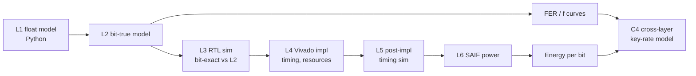

# 01 — Project Charter

| Field | Value |
|---|---|
| Title | A rate-adaptive, low-power FPGA accelerator for discrete-variable QKD key distillation on a Zynq-7020 |
| Author | Bishnu Prasad Kar |
| Guide | *(to be filled)* |
| Version | 0.1 (draft), 21 Sep 2026 |
| Status | Awaiting guide review |

---

## 1. Problem statement

A QKD link does not deliver a finished key. After the quantum exchange, Alice and Bob hold correlated but unequal bit strings. Bob's copy differs from Alice's at a fraction $Q$ of positions (the QBER), and an eavesdropper may have partial information. A classical post-processing chain must:

1. Reconcile the two strings (error correction over a public channel).
2. Verify that they are now identical.
3. Compress the result so that the eavesdropper's information becomes negligible (privacy amplification).

Modern detectors support secret-key rates of tens of Mbps. For example, Grünenfelder et al. (2023) report 64 Mbps over 10 km. Post-processing therefore has to keep pace in real time. Published FPGA accelerators mostly target large, power-hungry devices: Virtex-6, and Kintex UltraScale estimated at about 34 W. Discrete-variable LDPC reconciliation on low-cost hardware has received less attention than the continuous-variable case. Two parameters strongly affect the final key rate, and both are constrained by hardware memory:

- **Reconciliation efficiency $f$**, which depends on LDPC frame length.
- **Finite-key penalty**, which depends on privacy-amplification block size.

They are rarely co-designed.

## 2. Research question

> **How much secret key per watt can a low-cost FPGA SoC distil, and how should LDPC frame length and privacy-amplification block size be chosen within its memory limits?**

Sub-questions:

- **RQ1:** What reconciliation efficiency and frame error rate can a hardware-friendly, rate-adaptive QC-LDPC code set achieve over $Q \in [1\%, 10\%]$ at frame lengths that fit on-chip memory?
- **RQ2:** What throughput, resource use and energy per bit can a layered normalized min-sum syndrome decoder achieve on `xc7z020`?
- **RQ3:** How should privacy amplification be implemented under the memory limits of a Zynq-7020, where large blocks must be streamed through PS DDR?
- **RQ4:** Which combination of frame length $n_f$ and block size $N$ maximises final secret-key rate per watt at representative fibre distances?

## 3. Contributions

| ID | Contribution | Answers |
|---|---|---|
| **C1** | Hardware-aware, rate-adaptive QC-LDPC code set for $Q = 1$–$10\%$: one mother code plus puncture/shorten masks, with a fixed-point quantisation study | RQ1 |
| **C2** | Layered normalized min-sum syndrome decoder in SystemVerilog on `xc7z020`: throughput, resources, estimated power, energy per bit | RQ2 |
| **C3** | Memory-bounded privacy-amplification and verification datapath sharing GF(2) multiply logic, streaming large blocks through PS DDR | RQ3 |
| **C4** | Cross-layer model linking $n_f$, $N$, BRAM/DDR use and the finite-key penalty to secret key rate per watt, with the optimum for this device | RQ4 |
| **C5** | Open-source RTL, reference models and reproducible scripts | All |

## 4. Scope

### In scope
- Information reconciliation (LDPC), error verification and privacy amplification, as algorithms, reference models and RTL.
- Rate adaptation over QBER 1–10%.
- A Zynq-7020 system design: PL accelerator plus PS control model, with AXI interfaces.
- Verification by simulation. Evaluation by Vivado post-implementation reports.
- Finite-key key-rate analysis using a published decoy-state BB84 security proof and published system parameters.

### Out of scope
- Optics, detectors, or any physical QKD link.
- Sifting and decoy-state parameter estimation hardware. These are modelled in software on the PS side.
- Authentication hardware. The authenticated channel is assumed and its key cost is noted in the analysis.
- New security proofs. We apply existing ones.
- Continuous-variable QKD.
- Programming a physical board. This is optional future work.

## 5. Approach (summary)

The [algorithm spec](05-algorithm-spec.md) is the single source of truth. Every model and the RTL implement it exactly, and each verification level proves the next.

## 6. Success criteria

| Level | Criterion |
|---|---|
| **Minimum (publishable)** | C1 + C2 complete: code set meets the efficiency and FER targets in [03-requirements](03-requirements.md); decoder RTL passes L3–L5; timing met on `xc7z020`; conference paper submitted |
| **Target** | C1–C4 complete; full pipeline integrated in a PS–PL block design; journal paper submitted |
| **Stretch** | NTT-based privacy amplification for blocks ≥ 10⁶ bits; bitstream run on a borrowed board |

## 7. Deliverables and timeline

| Month | Deliverable | Documents updated |
|---|---|---|
| M1 (Oct 2026) | Gap statement, requirements v1.0, toolflow proven | 01–04, 12 |
| M2 | Python reference model (L1) and baseline curves | 05, 10 |
| M3 | Code set + bit-true model (L2) | 06, 11 |
| M4 | Decoder RTL passing L3 | 07, 08, blocks/ldpc-decoder |
| M5 | Decoder implemented (L4–L6); **Paper 1 submitted** | results |
| M6 | Verification + PA RTL; block design; system sim | blocks/*, 08 |
| M7 | Cross-layer study; comparison table | 11, results |
| M8 (May 2027) | **Paper 2 submitted**; open-source release | all |

## 8. Resources

| Resource | Cost | Notes |
|---|---|---|
| Laptop (Windows 11 + WSL2) | Owned | Simulation and Vivado runs |
| AMD Vivado, pinned version | Free | See [ADR-002](decisions/ADR-002-toolchain-and-vivado-version.md) |
| Verilator, Icarus, cocotb, Python | Free | |
| Publication fees | Variable | Prefer subscription venues or waivers |

## 9. Risk register

| Risk | Likelihood | Mitigation |
|---|---|---|
| Someone publishes the same idea | Medium | Keep the related-work matrix live and set arXiv alerts. The combined low-power and cross-layer angle is hard to duplicate exactly. |
| Decoder doesn't fit in BRAM | Medium | Compressed check-node storage, a shorter frame, or XC7A100T as a second data point |
| Timing fails at the target clock | High at first | Pipeline the min-finder and APP update. Report Fmax honestly. |
| Poor efficiency or an error floor | Medium | Density-evolution-guided degree distribution; tune α/β; cross-check with AFF3CT |
| Direct Toeplitz PA too slow for large blocks | High | Measure it (C3) and treat the throughput–block-size trade-off as a finding for C4. NTT-based PA is a stretch goal. |
| Reviewer asks for real hardware | Medium | Clear scope statement; L5 timing sim and SAIF power; open-source release; borrow a board later |
| Vivado licensing changes | Low–medium | Pinned version ([ADR-002](decisions/ADR-002-toolchain-and-vivado-version.md)); open-source simulators |
| Scope creep | High | C1 + C2 is the minimum. Everything else is an extension. |

## 10. Approval

| Role | Name | Date | Signature / comment |
|---|---|---|---|
| Student | Bishnu Prasad Kar | | |
| Guide | | | |
