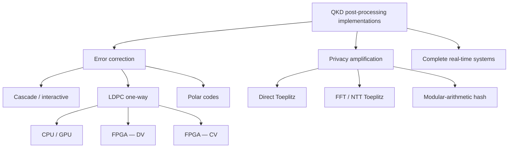

# 02 — Related Work and Gap Statement

| Version | 0.1 (seed survey, Sep 2026) |
|---|---|
| Machine-readable matrix | [related-work.csv](related-work.csv). Add every paper you read as a row. |

> **Status:** this is a *seed* survey from a first pass. Month 1 turns it into a full review. Numbers are as reported by the authors, so check the originals before citing.

---

## 1. Search strategy

| Source | Query terms (combine) |
|---|---|
| IEEE Xplore, Google Scholar, arXiv (quant-ph, eess.SP, cs.AR) | "QKD" / "quantum key distribution" AND ("post-processing" OR "key distillation" OR "information reconciliation" OR "privacy amplification") AND ("FPGA" OR "hardware" OR "GPU" OR "ASIC") |
| | "LDPC" AND "QKD" AND ("rate-adaptive" OR "rate-compatible" OR "blind reconciliation") |
| | "Toeplitz" AND "privacy amplification" AND ("FPGA" OR "NTT" OR "FFT") |
| | "finite-key" AND "decoy" AND "block size" |
| Forward citations | Papers citing Constantin 2017, Li Q. 2019, Mao & Li 2019, Liao 2025 |

**Inclusion rule:** DV-QKD post-processing with implementation results (FPGA, ASIC, GPU or CPU). CV-QKD FPGA work is included only as a contrast. **Alerts:** set Google Scholar alerts on the four forward-citation papers.

## 2. Taxonomy

## 3. Seed literature

### 3.1 Complete systems with hardware distillation

| Work | What | Platform | Result | Validation |
|---|---|---|---|---|
| Walenta et al., *New J. Phys.* 16, 013047 (2014) | 625 MHz COW QKD with hardware key distillation | FPGA | Real-time distillation up to 4 Mbps | Real system |
| Constantin et al., *J. Signal Process. Syst.* (2017) | Sifting, LDPC error correction, parameter estimation, PA | Virtex-6 LX240T | Up to 4 Mbps distilled; 140 kbps secret over 25 km | Real system |
| Grünenfelder et al., *Nat. Photon.* 17, 422 (2023) | 2.5 GHz time-bin QKD with real-time distillation | Detectors + distillation electronics | 64 Mbps @ 10.0 km; 3.0 Mbps @ 102.4 km | Real system |
| Li W. et al., *Nat. Photon.* (2023) | High-rate QKD | — | > 110 Mb/s | Real system |

### 3.2 Error correction

| Work | Method | Platform | Result | Validation |
|---|---|---|---|---|
| Brassard & Salvail, EUROCRYPT '93 | Cascade | — | Original interactive protocol | Theory |
| Pedersen & Toyran, arXiv:1307.7829 | Optimised Cascade | CPU | High-performance Cascade | Software |
| Elkouss, Martinez-Mateo & Martin, QIC 11 (2011) | Rate-adaptive LDPC (puncture/shorten) | — | Efficiency across QBER range from one code | Simulation |
| Martinez-Mateo et al., QIC 12 (2012) | Blind reconciliation | — | No precise QBER estimate needed | Simulation |
| Kiktenko et al., *Phys. Rev. Applied* 8, 044017 (2017) | Symmetric blind reconciliation | — | Improved blind scheme | Simulation / system |
| Dixon & Sato, *Sci. Rep.* 4, 7275 (2014) | Rate-adaptable LDPC | GPU | Mbit/s-rate error correction | Software |
| Mao & Li, *Quantum Inf. Process.* (2019) | Quantised LDPC decoder | Low-cost CPU | Up to 60 Mbps at f ≈ 1.1 | Software |
| **Liao et al., *Sci. Rep.* (2025)** | Polar codes, CA-SCL | Kintex UltraScale KU040 + DDR | 35.33 Mbps at N = 2²⁰, f ≈ 1.11, Q = 1–10%, ≈ 34.4 W est. | **Synthesis + P&R only** |
| CV-QKD LDPC decoder (2023) | LDPC for CV-QKD | FPGA | 108.64 Mb/s at 262,144-bit codes, SNR 1.0 dB | FPGA (different regime) |

### 3.3 Privacy amplification

| Work | Method | Platform | Result | Validation |
|---|---|---|---|---|
| Yang et al., *IEEE Photonics J.* 9 (2017) | Size-adaptive Toeplitz | FPGA | Adjustable input size | FPGA |
| Li Q. et al., *IEEE Access* 7 (2019) | FFT-based Toeplitz | Virtex-6 | ≈ 2× earlier FPGA Toeplitz throughput | FPGA experiment |
| Tang et al., *Sci. Rep.* (2019) | Large-scale PA scheme | Software | Large input sizes at high speed | Software |
| Yan, Li & Mao, arXiv:2107.01013 (+ IEEE version) | MMH-MH hashing + NTT | FPGA | 10⁸-bit input at 1 Gbps (prior FPGA best: 116 Mbps at 10⁶) | FPGA |
| Hayashi & Tsurumaru, *IEEE Trans. Inf. Theory* 62 (2016) | Modified Toeplitz / dual universal hashing | — | Shorter seeds | Theory |

### 3.4 Security and finite-key analysis
- Lim, Curty, Walenta, Xu & Zbinden, *Phys. Rev. A* 89, 022307 (2014). Decoy-state finite-key bounds, used in [04-system-model](04-system-model.md).
- Tomamichel, Lim, Gisin & Renner, *Nat. Commun.* 3, 634 (2012). Tight finite-key analysis.
- "A consolidated and accessible security proof for finite-size decoy-state QKD," *Quantum* (2026).

## 4. Observations

1. **Chip class.** The most-cited FPGA post-processing results use large devices (Virtex-6 LX240T, Kintex UltraScale KU040). The one power figure we found is about 34 W (estimated) for 35 Mbps, roughly 970 nJ/bit.
2. **DV vs CV.** Recent FPGA LDPC decoders concentrate on CV-QKD (low SNR, multi-edge codes, 10⁵-bit frames). DV-QKD rate-adaptive syndrome decoders on low-cost parts appear less covered.
3. **Validation practice.** At least one 2025 journal paper (Liao) reports synthesis and place-and-route results without a deployed QKD testbed. That is a precedent for our methodology.
4. **PA scaling.** Direct Toeplitz costs grow as $N \cdot \ell$. Large blocks (≥ 10⁶) push designs towards FFT/NTT or modular-arithmetic hashing. This throughput-vs-block-size tension is under-reported, even though it drives the finite-key penalty.
5. **Metrics.** Energy per bit and resource-normalised throughput are rarely reported, which makes cross-platform comparison hard.

## 5. Gap statement (draft for guide review)

> Existing FPGA implementations of QKD post-processing target large, high-power devices. Recent hardware reconciliation work focuses on continuous-variable QKD. To our knowledge, no work jointly designs (i) a rate-adaptive discrete-variable LDPC syndrome decoder and (ii) privacy amplification for a low-cost FPGA SoC, while (iii) choosing LDPC frame length and privacy-amplification block size together under on-chip and off-chip memory limits to maximise finite-key secret-key rate per watt. This project fills that gap on a Zynq-7020, reporting post-implementation throughput, resources and estimated energy per secret bit.

**Before approving:** each "to our knowledge" claim must survive the Month-1 search. Record any paper that weakens a claim in the matrix, and revise this paragraph.

## 6. Month-1 to-do

- [ ] Read the five "start here" papers in the [learning guide reading list](00-learning-guide.md#reading-list).
- [ ] Extend the matrix to ≥ 30 papers, with a focus on 2022–2026 FPGA/ASIC work.
- [ ] For each hardware paper, record: device, n or N, f, FER, throughput, power (and whether measured or estimated), validation type.
- [ ] Re-test gaps 1–4. Rewrite §5.
- [ ] Get guide sign-off on §5.
