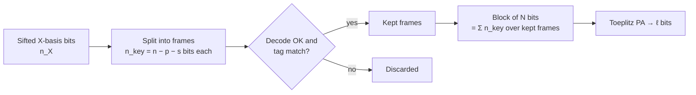

# 04 — System Model

| Version | 0.1 (draft), 21 Sep 2026 |
|---|---|
| Purpose | Fix the protocol, channel and security assumptions, and the notation used by every other document |

---

## 1. Protocol and roles

- **Protocol:** decoy-state BB84 with weak coherent pulses, following the finite-key analysis of Lim et al. (2014). Their convention is that the **key** comes from the X-basis events, and the **phase error rate** is estimated from the Z basis.
- **Reconciliation direction:** direct reconciliation. Alice's sifted string $x_A$ is the reference, and Bob corrects $y$ towards it.
- **Scope boundary:** this project starts from *sifted, sampled* key frames and ends at the final secret key. Everything before sifting is modelled only through its statistics.

```mermaid
sequenceDiagram
  participant A as Alice (PS + PL)
  participant C as Authenticated public channel
  participant B as Bob (PS + PL)
  Note over A,B: Quantum exchange, sifting, parameter estimation (modelled)
  A->>C: frame syndrome s = H·x_A, rate mask id
  C->>B: s, mask id
  B->>B: LDPC decode y → x̂ (PL)
  A->>C: verification seed + tag V(x_A)
  C->>B: seed, tag
  B->>B: compare V(x̂); keep or drop frame
  A->>C: PA seed, output length ℓ
  C->>B: seed, ℓ
  A->>A: k_A = T·x_A (PL)
  B->>B: k_B = T·x̂ (PL)
```

## 2. Sifted-key channel model (used for reconciliation experiments)

For experiments E1–E4, Bob's sifted bits are modelled as Alice's bits passed through a **binary symmetric channel** BSC($Q$):

$$y_j = x_{A,j} \oplus e_j,\qquad e_j \stackrel{\text{i.i.d.}}{\sim} \text{Bernoulli}(Q).$$

Alice's bits $x_{A,j}$ are i.i.d. uniform. This model is the standard choice for DV-QKD reconciliation studies.

**Limitations**, stated in every paper that uses this model:

- Real errors can be correlated in time (detector after-pulsing, drift). Burst errors would raise the FER for a given $Q$.
- $Q$ is assumed known to the decoder up to an estimation error. [E1](11-evaluation-plan.md) will add an *estimation-mismatch* sweep, where the decoder uses $\hat{Q} \neq Q$.

## 3. Physical link model (used for key-rate experiments E5 and E6)

We use the standard weak-coherent-pulse model (Ma, Qi, Zhao & Lo, *Phys. Rev. A* 72, 012326, 2005). For a pulse of mean photon number $\mu$ over fibre length $L$:

$$\eta = \eta_{Bob}\,\eta_{det}\,10^{-\alpha L/10}$$

$$Q_\mu = Y_0 + 1 - e^{-\eta\mu}\qquad\text{(gain)}$$

$$E_\mu Q_\mu = e_0 Y_0 + e_d\,(1 - e^{-\eta\mu}),\qquad e_0 = \tfrac12\qquad\text{(QBER } E_\mu\text{)}$$

| Symbol | Meaning | Value |
|---|---|---|
| $\alpha$ | Fibre attenuation | 0.2 dB/km (standard single-mode fibre, 1550 nm) |
| $\eta_{Bob}$ | Bob's optical transmittance | from chosen reference system (TBC) |
| $\eta_{det}$ | Detector efficiency | from chosen reference system (TBC) |
| $Y_0$ | Background (dark-count) yield per pulse | from chosen reference system (TBC) |
| $e_d$ | Misalignment / intrinsic error | from chosen reference system (TBC) |
| $f_{rep}$ | Pulse repetition rate | from chosen reference system (TBC) |
| $\mu_1,\mu_2,\mu_3$ | Signal and decoy intensities | optimised per distance, or taken from the reference |

**Action (M1):** choose one published system as the *reference parameter set* (for example Boaron et al. 2018 or Grünenfelder et al. 2023). Copy its parameters into this table with the citation, and record the choice in an ADR. Using published parameters makes the E5 key-rate curves credible.

### 3.1 Asymptotic sanity check (GLLP with decoys)

Before running the finite-key calculation, check the model against the asymptotic decoy-state key rate (Lo, Ma & Chen 2005):

$$R \ge q\left\{-Q_\mu\, f\, h(E_\mu) + Q_1\,[1 - h(e_1)]\right\}$$

with $Q_1 = Y_1\,\mu e^{-\mu}$. In the infinite-decoy limit, $Y_1 \approx Y_0 + \eta$ and $e_1 = (e_0 Y_0 + e_d\eta)/Y_1$. Here $q$ is the sifting factor ($\tfrac12$ for symmetric BB84). Our finite-key rate must lie **below** this curve at every distance.

## 4. Pipeline accounting



| Quantity | Definition |
|---|---|
| $n$ | Mother-code length (65,536) |
| $m$ | Number of parity checks in the mother code |
| $p, s$ | Punctured and shortened positions per frame (set by the rate mask) |
| $n_{key} = n - p - s$ | Key bits carried per frame |
| $K$ | Frames kept in a block |
| $N = \sum_{k=1}^{K} n_{key,k}$ | Block length entering PA |
| $\lambda_{EC}$ | Total leakage for the block (REQ-SEC-01) |
| $\ell$ | Final key length (§5) |

Net secret-key throughput for a hardware pipeline running at $T$ decoded bits per second:

$$T_{key} \approx T\cdot\frac{n_{key}}{n}\cdot(1 - \text{FER})\cdot\frac{\ell}{N}.$$

## 5. Finite-key secret-key length

We use the decoy-state BB84 bound of Lim et al. (2014):

$$\ell = \left\lfloor s_{X,0} + s_{X,1}\left(1 - h(\phi_X)\right) - \lambda_{EC} - 6\log_2\frac{21}{\varepsilon_{sec}} - \log_2\frac{2}{\varepsilon_{cor}}\right\rfloor$$

| Symbol | Meaning | Source |
|---|---|---|
| $s_{X,0}$ | Lower bound on vacuum events in the X basis | Decoy-state estimate (Lim et al. 2014) |
| $s_{X,1}$ | Lower bound on single-photon events in the X basis | Decoy-state estimate |
| $\phi_X$ | Upper bound on the single-photon phase error rate | Estimated from Z-basis errors plus a statistical correction |
| $\lambda_{EC}$ | Information disclosed by reconciliation and verification | **This project's hardware** (REQ-SEC-01) |
| $\varepsilon_{sec}, \varepsilon_{cor}$ | Secrecy and correctness parameters | REQ-SEC-02 |

**Action (M1):** transcribe the exact expressions for $s_{X,0}$, $s_{X,1}$ and $\phi_X$, including the Hoeffding/Chernoff correction terms, directly from Lim et al. (2014) into [`model/finite_key.py`](../model/). Unit-test against a numeric example from the paper or a later paper that reproduces it. Do **not** re-derive them.

With the project defaults, the two constant penalty terms are fixed:

| Term | Value |
|---|---|
| $6\log_2(21/\varepsilon_{sec})$ with $\varepsilon_{sec} = 10^{-9}$ | ≈ 205.7 bits |
| $\log_2(2/\varepsilon_{cor})$ with $\varepsilon_{cor} = 10^{-12}$ | ≈ 40.9 bits |

The main block-size effect comes from the statistical corrections inside $s_{X,1}$ and $\phi_X$, which shrink roughly as $1/\sqrt{\text{sample size}}$. Example: a Hoeffding deviation $\sqrt{\ln(1/\varepsilon)/(2n)}$ with $\varepsilon = 10^{-10}$ is 3.4% at $n = 10^4$ but 0.34% at $n = 10^6$. This is the effect the C4 study trades against hardware cost.

## 6. Randomness

| Randomness | Who generates it | Public? | In simulation |
|---|---|---|---|
| Punctured-position fill bits | Alice | No (private) | NumPy `Generator(PCG64)`, fixed seed per run |
| Shortened-position values | Alice, shared with Bob | Yes | Deterministic (all zeros), see [05 §3.3](05-algorithm-spec.md#33-rate-adaptation-puncturing-and-shortening) |
| Verification seed (per frame) | Alice, chosen *after* decoding | Yes | PCG64 |
| PA seed (per block) | Alice, chosen *after* verification | Yes | PCG64 |

In deployment, Alice's randomness would come from a certified RNG (for example a QRNG). The simulation seeds are recorded for reproducibility (REQ-REP-01).

## 7. Authentication

The classical channel is assumed authenticated, for example with Wegman–Carter universal hashing and a pre-shared key. Its key consumption per round is small compared with $\ell$ and is **not** implemented here. The C4 analysis notes it as a constant cost.

## Notation

| Symbol | Meaning |
|---|---|
| $Q$ | Quantum bit error rate of the sifted key (probability $x_{A,j} \ne y_j$) |
| $\hat{Q}$ | Estimated QBER used for rate selection and LLRs |
| $h(p)$ | Binary entropy, $-p\log_2 p - (1-p)\log_2(1-p)$ |
| $x_A, y, \hat{x}$ | Alice's frame, Bob's received frame, Bob's decoded frame |
| $H$ | $m \times n$ parity-check matrix of the mother code |
| $s = Hx_A$ | Syndrome (mod 2) |
| $R_0 = 1 - m/n$ | Mother-code design rate |
| $\pi = p/n,\ \sigma = s/n$ | Punctured and shortened fractions |
| $R = (R_0 - \sigma)/(1 - \pi - \sigma)$ | Effective rate after rate adaptation |
| $f = (1 - R)/h(Q)$ | Reconciliation efficiency |
| $L_j$ | A-posteriori LLR of variable $j$ (positive means bit 0) |
| $R_{ij}$ | Check-to-variable message from check $i$ to variable $j$ |
| $\alpha$ | Normalisation factor of normalized min-sum |
| $Z$ | Lifting (circulant) size of the QC-LDPC code |
| $n_b, m_b$ | Base-matrix columns and rows ($n = n_b Z$, $m = m_b Z$) |
| $I_{max}, I_{avg}$ | Maximum and average decoder iterations |
| FER | Frame error rate (frames not correctly decoded and verified) |
| $t$ | Verification tag length (64) |
| $N, \ell$ | PA input and output lengths |
| $\varepsilon_{sec}, \varepsilon_{cor}$ | Secrecy and correctness parameters |
