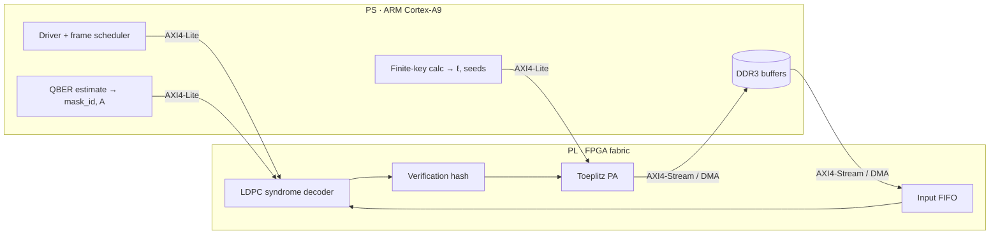

# 07 — Hardware Architecture

| Version | 0.0 (outline), 21 Sep 2026 |
|---|---|
| Owner milestone | M3–M4 |

> **Outline.** The structure and the known design intent are captured now. Budgets are filled in once [06](06-ldpc-code-design.md) fixes the code.

## 1. System context

## 2. PS/PL partitioning rationale
- **PL:** everything that runs per bit and per iteration (decoding, hashing).
- **PS:** per-block decisions (rate selection, ℓ, seeds) and DDR buffering of large PA blocks.

## 3. Dataflow and frame lifecycle
To document: the sequence per frame (load $y$, $s$, mask, $A$ → decode → status → verification → accumulate into the block → PA), buffering, and back-pressure.

## 4. Clocking and reset
Single PL clock domain (target ≥ 125 MHz, REQ-IMP-02); AXI clock equal to the core clock unless timing forces a split. Synchronous active-low reset `rst_n` (see [13](13-rtl-coding-guidelines.md)).

## 5. Budgets

| Budget | Target | Source |
|---|---|---|
| Throughput | ≥ 50 Mbps decoder | REQ-PERF-04 |
| Latency | ≤ 2 ms per frame (TBC) | REQ-PERF-05 |
| LUT / BRAM / DSP | ≤ 70% / 80% / 50% | REQ-IMP-03 |
| Power | ≤ 1.0 W PL dynamic | REQ-PERF-06 |

### 5.1 Working estimate (from the learning guide §16)
$Z = 128$, $n_b = 512$, $m_b \approx 154$, $E_b \approx 1{,}792$, pipeline depth 8, 150 MHz, $I_{avg} = 12$: about 3,024 cycles per iteration, 242 µs per frame, **≈ 270 Mbps upper bound**. APP memory: 1,024 bits per cycle → about 15 BRAM36; check storage about 591 Kb → about 17 BRAM36. Replace these with real numbers after M3.

## 6. Memory map summary
See [08](08-interfaces-regmap.md).

## 7. Open decisions
Decoder parallelism $P$ (= $Z$?) · APP memory banking · PA method and block location (BRAM vs DDR) · verification-hash sharing with PA.
