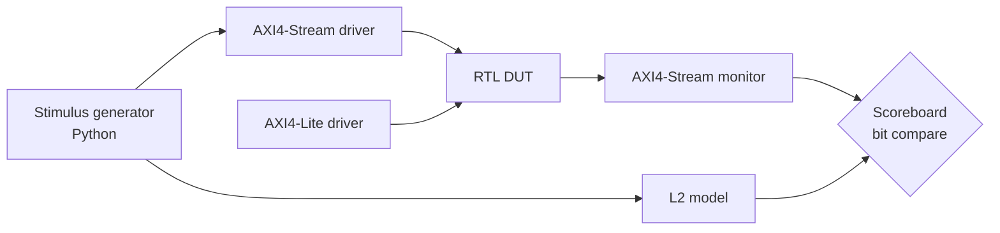

# 10 — Verification Plan

| Version | 0.0 (outline), 21 Sep 2026 |
|---|---|
| Owner milestone | Skeleton M2; complete by M4 |

## 1. Strategy: the verification ladder
Each level proves the next level valid, so simulation-only results are credible.

| Level | What | Evidence | Requirements |
|---|---|---|---|
| L1 | Floating-point reference model (Python + Numba) | FER, $f$, iterations against $Q$ | REQ-PERF-01…03 |
| L2 | Bit-true fixed-point model | Quantisation loss vs L1 | REQ-VER-05 |
| L3 | RTL simulation (cocotb + Verilator/Icarus, or xsim) | Bit-exact vs L2, ≥ 1,000 frames per point | REQ-VER-01 |
| L4 | Synthesis + implementation on `xc7z020clg400-1` | Utilisation, WNS ≥ 0, Fmax | REQ-IMP-02, 03 |
| L5 | Post-implementation timing simulation | Bit-exact with delays, ≥ 10 frames per rate | REQ-VER-03 |
| L6 | SAIF-annotated power | Estimated power and confidence | REQ-VER-04 |

**Why the FER curves come from L2:** low FER needs 10⁵–10⁶ frames, which is too slow in RTL simulation. L3 proves L2 equals the RTL, so L2's curves describe the hardware.

## 2. Testbench architecture (to fill)

## 3. Test list (to fill; each test cites REQ-IDs)

| Test ID | Description | Covers |
|---|---|---|
| T-DEC-01 | Single frame, Q = 5%, default mask | REQ-FUN-01 |
| T-DEC-02 | All masks × QBER grid, 1,000 frames each | REQ-FUN-03, REQ-VER-01 |
| T-DEC-03 | $I_{max}$ boundary; failure path | REQ-FUN-04, 05 |
| T-VER-01 | Tag match and mismatch | REQ-FUN-06, REQ-SEC-03 |
| T-PA-01 | PA with $N$ not a multiple of 64 | REQ-FUN-07 |
| T-IF-01 | AXI back-pressure and random TREADY | REQ-IF-01 |
| … | | |

## 4. Coverage goals
Functional coverage: every mask, the QBER bins, $I_{max}$ edges, and saturation events hit.

## 5. Regression
A single command runs all tests, with a nightly/before-commit subset. Results are logged to `results/` with the commit hash.
