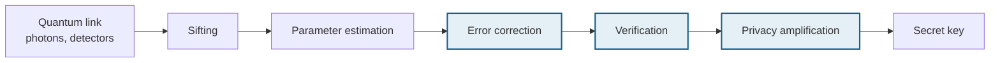
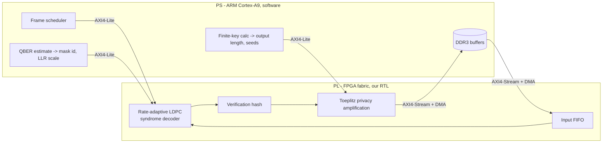
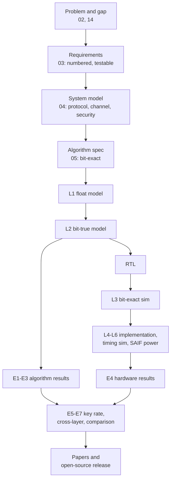

# 14 — Problem, Solution and Design Rationale

| Version | 0.1 (draft), 1 Oct 2026 |
|---|---|
| Purpose | A single self-contained account of **what problem we solve, what we build, why every choice was made, and how we will prove it**. Written for the guide, for reviewers, and for the introduction and methodology sections of the papers. |
| Relation to other docs | This document explains *why*. The [charter](01-charter.md) states scope, [03](03-requirements.md) states targets, [05](05-algorithm-spec.md) states exact behaviour, and the [ADRs](decisions/) record individual decisions. Where numbers appear here, their source is named. |

---

## 1. Executive summary

Quantum key distribution (QKD) ends with a classical pipeline that corrects errors in the raw key and then compresses it until an eavesdropper's knowledge is negligible. Detectors have become fast enough to produce tens of megabits of secret key per second, so this classical "key distillation" is now the bottleneck, and the published hardware that performs it runs on large, expensive, power-hungry FPGAs.

**This project builds rate-adaptive key-distillation hardware for a low-cost FPGA SoC (Zynq-7020) and treats the memory limits of that device as a first-class design variable.** Those limits set two things that normally get decided separately: the LDPC frame length (which sets reconciliation efficiency) and the privacy-amplification block size (which sets the finite-key penalty). We design both together for maximum secret key per watt.

The work is validated entirely in simulation plus Vivado post-implementation reports, with no FPGA board and no optics. That is an accepted methodology at hardware venues, and it has direct precedent in this exact topic (Liao et al., *Scientific Reports*, 2025). The toolchain is installed and pinned (Vivado 2025.2, `xc7z020clg400-1`); the week-1 flow test that proves it end to end is run by hand in the GUI, following [15-vivado-gui-guide](15-vivado-gui-guide.md).

---

## 2. Problem statement

### 2.1 Where the problem sits

Everything after the quantum link is classical computation on ordinary electronics. The three shaded stages dominate the computational cost, and they are this project's subject.

### 2.2 Why it is urgent now

| Evidence | Source |
|---|---|
| 64 Mbps secret key over 10 km, 3.0 Mbps over 102.4 km, explicitly enabled by **real-time key distillation electronics** | Grünenfelder et al., *Nat. Photon.* 17, 422 (2023) |
| Secret key rate exceeding 110 Mb/s | Li W. et al., *Nat. Photon.* (2023) |
| FPGA polar-code reconciliation: 35.33 Mbps on a Kintex UltraScale KU040 with external DDR, **≈ 34.4 W estimated** (≈ 974 nJ per corrected bit) | Liao et al., *Sci. Rep.* (2025) |
| Software LDPC reconciliation: up to 60 Mbps on a CPU at f ≈ 1.1 | Mao & Li, *Quantum Inf. Process.* (2019) |

Optics now out-runs the classical back end. If QKD is to leave the laboratory and sit in a metro node, a street cabinet or an embedded security appliance, distillation has to run at tens of Mbps inside a few watts and a few thousand rupees of silicon, not tens of watts on a flagship FPGA.

### 2.3 The precise problem

> **Given a low-cost FPGA SoC with roughly 5 Mb of on-chip memory, how much secret key per watt can be distilled from a DV-QKD link across the full operating QBER range, and how should the LDPC frame length and the privacy-amplification block size be chosen within those memory limits?**

Four technical difficulties make this non-trivial.

**(a) Efficiency is bought with memory.** Reconciliation leaks at least $n\,h(Q)$ bits (Slepian–Wolf). Real codes leak $f$ times that, and $f$ approaches 1 only with long codes. Long codes need memory the device does not have. The cost is direct: at $Q = 5\%$, moving from $f = 1.0$ to $1.1$ costs 6.7% of the final key, and $f = 1.2$ costs 13.4%.

**(b) The code rate must track the QBER.** The required rate is $R = 1 - f\,h(Q)$, which spans **0.484 to 0.911** over $Q = 1$–10%. A single fixed code cannot serve that range efficiently, and storing a dozen parity-check matrices wastes the memory that (a) already made scarce.

**(c) Privacy amplification scales badly in exactly the wrong direction.** Direct Toeplitz hashing costs $N\ell$ bit operations, so throughput falls as $1/N$:

| Block $N$ | Direct-method throughput (16 bits/cycle × 1,024-bit chunk, 150 MHz, $\ell = N/2$) |
|---|---|
| $10^5$ | ≈ 49 Mbps |
| $10^6$ | ≈ 4.9 Mbps |
| $10^7$ | ≈ 0.49 Mbps |

But finite-key security *rewards* large blocks: the statistical margin shrinks like $1/\sqrt{\text{block}}$ (a Hoeffding deviation at $\varepsilon = 10^{-10}$ is 3.4% at $10^4$ samples and 0.34% at $10^6$). Hardware wants small blocks; security wants large ones. Nobody can choose well without measuring both sides on the same device.

**(d) Correctness must be proven, not assumed.** An iterative decoder can satisfy the syndrome yet converge to the wrong word. If that passes into privacy amplification, Alice and Bob end up with different keys. The system needs cheap, provable verification, and its cost must be charged against the key.

### 2.4 What is missing in the literature

From the seed survey ([02](02-related-work.md), to be confirmed in the month-1 review):

1. FPGA distillation results concentrate on **large devices** (Virtex-6, Kintex UltraScale). The one power figure available is ≈ 34.4 W.
2. Recent FPGA LDPC reconciliation work targets **continuous-variable** QKD (low SNR, multi-edge codes). Discrete-variable rate-adaptive syndrome decoding on a low-cost part is thinner.
3. Frame length and PA block size are **not co-designed** against device memory and the finite-key penalty.
4. **Energy per secret bit** and resource-normalised throughput are rarely reported, so cross-platform comparison is guesswork.

### 2.5 Deliberately out of scope

Optics and detectors; sifting and decoy-state parameter estimation hardware (modelled in software); authentication hardware; new security proofs; continuous-variable QKD; programming a physical board. Rationale: each is either a different discipline, already solved, or impossible without equipment. Excluding them keeps an eight-month project finishable, which is itself a design decision ([charter §4](01-charter.md#4-scope)).

---

## 3. Our solution

### 3.1 In one sentence

A rate-adaptive QC-LDPC syndrome decoder, a universal-hash verifier and a Toeplitz privacy-amplification datapath, implemented in SystemVerilog on a Zynq-7020, with the processor handling per-block decisions, and with frame length and block size chosen by a cross-layer model that maximises secret key per watt.

### 3.2 Architecture

### 3.3 The five contributions

| ID | Contribution | Why it is a contribution |
|---|---|---|
| **C1** | Hardware-aware, rate-adaptive QC-LDPC code set covering $Q$ = 1–10% from one mother code, with a fixed-point study | Existing codes are designed for communication channels or for CV-QKD, not for a BRAM budget plus a DV-QBER range |
| **C2** | Layered normalized min-sum **syndrome** decoder on `xc7z020`, reported with throughput, area, estimated power and **energy per bit** | Published DV decoders are CPU/GPU or run on large FPGAs; energy per bit is rarely given |
| **C3** | Memory-bounded verification and privacy amplification sharing GF(2) multiply logic, with large blocks streamed through PS DDR | Quantifies the $1/N$ throughput wall on a small device rather than assuming a big one |
| **C4** | Cross-layer model: frame length × block size × memory × finite-key penalty → secret key per watt, and the optimum for this device | The central scientific claim; it connects coding, hardware and security accounting |
| **C5** | Open-source RTL, reference models, test vectors and scripts | Makes simulation-only results checkable, which is what earns trust without a board |

### 3.4 What success looks like

Minimum: C1 + C2, meeting the [requirement targets](03-requirements.md) ($f \le 1.15$ over $Q$ = 2–8%, FER ≤ 10⁻², ≥ 50 Mbps, ≤ 1 W PL dynamic, timing met at ≥ 125 MHz), published as a conference paper. Target: C1–C4 integrated and published as a journal paper.

---

## 4. Why we chose everything

### 4.0 The decision criteria

Every choice below was judged against the same five criteria, in this order:

| # | Criterion | Why it ranks here |
|---|---|---|
| 1 | **Scientific value** — does it serve a contribution (C1–C5)? | Work that serves no contribution is cost without return |
| 2 | **Evidence quality** — can the result be proven to a reviewer without a board? | The whole project rests on simulation-plus-implementation evidence |
| 3 | **Feasibility** — can one student finish it in eight months? | Over-ambition is the usual failure mode of a solo project |
| 4 | **Cost** — can it be done with ₹0 of new spend? | A hard constraint, not a preference |
| 5 | **Reproducibility** — can the result be regenerated later from the repository? | Required for publication and for the open-source release |

Each decision below states the alternatives, the evidence, and the consequence we accept. Individual decisions are also recorded as [ADRs](decisions/).

---

### 4.1 Problem-level choices

#### Why discrete-variable (DV) QKD, not continuous-variable (CV)

| Option | For | Against | Verdict |
|---|---|---|---|
| **DV (BB84-type)** | The sifted key is a plain binary symmetric channel, so reconciliation is classic binary LDPC work; most deployed systems and standards are DV; the FPGA literature for DV rate-adaptive decoders is thinner, so there is room | Needs decoy-state accounting for the key rate | **Chosen** |
| CV (coherent states) | Very active FPGA LDPC area | Low-SNR multi-edge-type codes, multidimensional reconciliation, heavy DSP calibration; the FPGA niche is already crowded (for example 108.64 Mb/s at 262,144-bit codes, 2023) | Rejected |

*Consequence:* our channel model is BSC($Q$), which is simple and standard, but real detectors can produce correlated errors. We state this as a validity threat (§6) and add an estimation-mismatch sweep to E1.

#### Why error correction, verification and privacy amplification, and not sifting or parameter estimation

Sifting and parameter estimation are **O(n) bookkeeping with tiny arithmetic**: compare basis labels, count mismatches in a sample. Reconciliation is **O(iterations × edges)** message passing, and privacy amplification is **O(N·ℓ)** bit operations. The compute, the memory and the power all concentrate in the three stages we accelerate. Spending FPGA area on sifting would be engineering without a research question.

#### Why validate in simulation rather than on a board

| Option | Cost | Evidence strength | Verdict |
|---|---|---|---|
| **Simulation + Vivado post-implementation reports** | ₹0 | Accepted at hardware venues; direct precedent in this topic (Liao et al. 2025 report synthesis and place-and-route results with no deployed QKD testbed) | **Chosen** |
| Buy a board (PYNQ-Z2, about ₹18–25k) | Exceeds budget | Adds a live demo, but not a different scientific claim | Deferred; a borrowed board is a stretch goal |
| Open-source flow (Yosys, nextpnr-xilinx, F4PGA) | ₹0 | Area numbers approximate; timing and power not trusted by reviewers | Rejected for headline numbers |

*Consequence:* we owe reviewers extra rigour — bit-exact equivalence, timing closure, post-implementation timing simulation and SAIF-based power (§5.2) — and we must never write "measured" or "demonstrated in real time" (REQ-REP-03).

---

### 4.2 Algorithm choices

#### Why LDPC, not Cascade or polar codes — [ADR-003](decisions/ADR-003-ldpc-over-cascade-and-polar.md)

| Option | Efficiency | Hardware behaviour | Verdict |
|---|---|---|---|
| Cascade | Good; the classic reference | **Interactive:** many round trips, each step depending on the previous answer. Latency-bound and sequential, so it wastes an FPGA | Software baseline only |
| **LDPC, syndrome-based** | f about 1.05–1.15 with long codes | One message; decoding is local, parallel and memory-bound in a way FPGAs suit; proven in deployed QKD systems (Constantin et al. 2017) | **Chosen** |
| Polar, SC/SCL | f about 1.11 at N = 2^20 (Liao 2025) | Successive cancellation is inherently serial; that work needed a large device plus external DDR and about 34.4 W | Comparison point |

#### Why syndrome coding rather than sending an encoded key

Alice sends the syndrome, not a codeword. Three consequences, all good: Alice needs **no encoder** (one sparse matrix-vector product instead); the leak is **exactly** the syndrome length, which keeps the security accounting simple and tight; and Alice's raw key stays the reference, so no key material is replaced by code structure.

#### Why layered scheduling and normalized min-sum

| Decision | Alternatives | Reason |
|---|---|---|
| **Layered** schedule | Flooding | Converges in roughly half the iterations, and needs no separate variable-node pass or separate message memory. Throughput is inversely proportional to iterations, so this is close to a free 2x |
| **Normalized min-sum** (alpha = 0.75) | Sum-product (tanh rule); plain min-sum; offset min-sum | Sum-product needs transcendental functions or large lookup tables. Plain min-sum overestimates check magnitudes (worked example: exact 0.660 against min-sum 1.0). Normalisation recovers most of the loss, and 0.75 is **two shifts and an add** — no multiplier, no table |
| **5–8 bit fixed point** | Floating point | Floating point in the datapath would multiply both area and memory, and memory is the binding constraint. The widths are not guessed: E2 sweeps them against the float model |

#### Why one mother code plus masks, not a bank of codes

Required rates span 0.484–0.911. The options were to store many matrices (memory we cannot spare, plus more control logic) or to adapt one code by **puncturing** (random fill bits, raises the rate) and **shortening** (known bits, lowers the rate), following Elkouss et al. (2011). The second needs one datapath and makes the rate a *register write*: the mask id travels in the frame header. Blind reconciliation (Martinez-Mateo 2012; Kiktenko 2017) removes the need for an accurate QBER estimate but reintroduces interactivity, so it is an extension, not the baseline.

*Consequence:* heavy puncturing or shortening degrades efficiency, so one mother code may not cover the whole range well. [06](06-ldpc-code-design.md) must check this and may choose two mother rates. We state this openly rather than assuming it works.

#### Why a 64-bit universal-hash tag for verification

The decoder's own syndrome check is necessary but not sufficient ([learning guide 9.9](00-learning-guide.md#99-stopping-and-failure-modes)). A 2-universal hash gives a **provable** bound: a wrong frame passes with probability at most 2^-64, so a block of 153 frames (about 10^7 bits) has a correctness failure probability of about 8.3 x 10^-18, far inside the 10^-12 target. The cost is 64 leaked bits per 65,536-bit frame (about 0.1%). We choose Toeplitz for the tag because it **reuses the privacy-amplification datapath** (contribution C3); a polynomial hash over GF(2^64) needs only a 64-bit seed and one carry-less multiplier, so it stays on the table as an ADR comparison.

#### Why Toeplitz hashing for privacy amplification

| Option | Why considered | Why not the default |
|---|---|---|
| **Toeplitz** | 2-universal, standard in QKD, structurally parallel, and reduces to a GF(2) polynomial product | Direct cost grows as N times the output length — accepted, and measured, because quantifying that wall is part of C3 and C4 |
| Modified Toeplitz | Shorter seed | An optional mode later; the plain form keeps the spec and the first implementation simple |
| MMH-MH with NTT (Yan et al. 2021) | 1 Gbps at 10^8 bits | Needs a large device and DSP-heavy modular arithmetic; a stretch goal here |
| FFT/NTT Toeplitz (Li Q. 2019) | Near-linear cost | Same reason; it is the planned escape route if C4 shows large blocks are essential |

#### Why the hardware generates no randomness

All seeds come from the processor (REQ-FUN-08). Entropy sourcing is a security-critical, auditable function, and in a deployed system it would come from a certified RNG or a QRNG. Keeping it out of the RTL means our security accounting never depends on an unproven on-chip generator, and simulation stays reproducible from a recorded seed.

---

### 4.3 Code-design choices

#### Why quasi-cyclic LDPC

A base matrix plus a lifting size gives three things a plain random code cannot: only the small base matrix is stored; the Z checks of a block row can be processed **in parallel**; and moving data between memories becomes a **cyclic rotation** (a barrel shifter) rather than arbitrary routing. QC structure is why FPGA LDPC decoders are practical at all.

#### Why every base entry must be a single circulant

With one circulant per non-zero base entry, each variable touches a layer at most once, so the Z parallel updates inside a layer are independent. That gives **bit-exact equivalence between parallel hardware and the serial reference model** ([05 section 3.1](05-algorithm-spec.md#31-code-representation-qc-ldpc)), which is the foundation of the whole verification argument. A code with multi-edge base entries would force either serialisation or an approximation we could not verify bit-exactly.

#### Why n = 65,536 and Z = 128

Memory is the binding constraint. Estimating layered-decoder storage at about 17.6 bits per codeword bit (8-bit APP values, compressed check state, one sign bit per edge, plus the input frame and syndrome):

| Frame n | Estimated memory | Zynq-7020 (5,040 Kb) | Artix-7 35T (1,800 Kb) |
|---|---|---|---|
| 16,384 | 288 Kb | 6% | 16% |
| **65,536** | **1,153 Kb** | **23%** | 64% |
| 131,072 | 2,307 Kb | 46% | 128% (does not fit) |
| 1,048,576 | 18,455 Kb | 366% (does not fit) | — |

65,536 leaves room for frame buffers, the hashing datapath and routing, while being long enough to approach f about 1.1 — far better than the roughly 8k-bit 5G NR codes. Z = 128 is then chosen to equal the decoder's parallelism P, which avoids splitting a circulant rotation across cycles, and gives 512 base columns.

---

### 4.4 Hardware choices

#### Why the Zynq-7020 — [ADR-006](decisions/ADR-006-target-device-zynq7020.md)

| Option | Memory / logic | Why not chosen |
|---|---|---|
| **XC7Z020** (PYNQ-Z2, Zybo Z7-20) | 53,200 LUT, 5,040 Kb BRAM, 220 DSP, **dual ARM Cortex-A9 with DDR3 controller** | **Chosen:** the hard processor gives per-block control and large DDR buffers without a soft CPU, it is the cheapest widely available SoC class, and a borrowed board could run the design later |
| XC7A35T / XC7A100T | 1,800 / 4,860 Kb BRAM, no hard CPU | The 35T cannot hold a 65,536-bit frame comfortably; neither has a processor, so streaming PA blocks would need a soft CPU or a host. **The 100T is retained as a second data point** for area and timing |
| Kria K26, UltraScale+ | Much more memory | Undermines the low-cost claim, which is the project's whole premise |
| Intel Cyclone V SoC (Quartus Lite) | Comparable class | A viable fallback, but Xilinx 7-series has more comparable published QKD work, and Vivado is already installed and proven here |

Speed grade **-1** (the slowest commercial grade) is deliberate: it makes the timing result conservative rather than flattering.

#### Why this PS/PL split

Per-bit, per-iteration work (decoding, hashing) goes in the fabric, because that is where parallelism pays. Per-block decisions go in software, because they are infrequent, arithmetic-heavy and liable to change: QBER estimation and mask selection, the finite-key length calculation, seed handling, and moving million-bit blocks through DDR. Putting the finite-key mathematics in software also means a security-proof update is a software change, not a redesign of the RTL.

#### Why AXI4-Stream and AXI4-Lite

They are the Zynq-native interfaces, so DMA, interconnect and driver support come for free; they are vendor-standard, so reviewers recognise them; and the stream handshake is easy to test with randomised back-pressure. Streams carry frames, Lite carries configuration and status. No custom protocol is invented, because inventing one would cost time and prove nothing.

#### Why compressed check-node storage

Storing every check-to-variable message costs one word per edge. Storing only (min1, min2, index, sign bits) per check reconstructs every message **exactly**, cutting check memory several-fold. It is bit-exact, not an approximation, so it costs nothing in the verification argument.

---

### 4.5 Tooling choices

| Choice | Alternatives considered | Reason |
|---|---|---|
| **Vivado 2025.2** ([ADR-002](decisions/ADR-002-toolchain-and-vivado-version.md)) | Vivado 2026.1 | From 2026.1 the free BASIC tier needs a licence file renewed every 12 months, with simulation and debug features AMD describes as limited. 2025.2 needs no licence for 7-series or Zynq-7000, so results stay reproducible for years. Installed and pinned |
| **SystemVerilog-2012** ([ADR-005](decisions/ADR-005-systemverilog.md)) | Verilog-2001, VHDL | Parameterisation and `always_ff` / `always_comb` typing remove whole classes of bugs; supported by Vivado, Verilator and cocotb. VHDL would rule out Verilator |
| **RTL for the decoder, HLS allowed for hashing** | Pure HLS | The decoder's memory organisation and pipeline *are* the contribution, and HLS would hide exactly what we want to report. HLS is fine for exploring the PA datapath |
| **Verilator with cocotb** as the primary simulator | Vivado xsim, Questa | Fast, free, scriptable, and independent of Vivado's licence tier. cocotb lets the **same Python reference model** drive the testbench and check the results, which is what makes bit-exact comparison cheap |
| **Python, NumPy and Numba** for models | C++, MATLAB | One language for the model, the testbench and the plots. Numba makes the Monte-Carlo sweeps fast enough, and MATLAB is not free |
| **AFF3CT** as an independent check | Trusting our own decoder | An independent implementation catches errors that self-consistency cannot |
| **Markdown docs in git** ([ADR-001](decisions/ADR-001-docs-as-markdown-in-repo.md)) | Word, online documents | Specs diff like code, stay beside the RTL, and export to PDF when the college needs it |

### 4.6 Summary of rejected options

| Rejected | Primary reason |
|---|---|
| CV-QKD | Crowded FPGA niche, heavier DSP, a different problem |
| Cascade in hardware | Interactive and latency-bound |
| Polar codes as the main decoder | Serial decoding, large memory, already done on a big device |
| Fully parallel decoder | Routing is infeasible at n = 65,536 |
| Bank of fixed-rate codes | Memory cost and control complexity |
| On-chip RNG | Security-critical entropy belongs outside the accelerator |
| Buying a board now | Outside budget, and it adds no new scientific claim |
| Open-source FPGA flow for headline numbers | Timing and power not credible to reviewers |
| Vivado 2026.1 | Annual licence renewal and unclear feature limits |

---

## 5. Methodology

### 5.1 The research cycle

This is engineering design research: the artefact *is* the result, so the method must make the artefact's properties measurable and checkable by someone else.

Two rules hold the method together:

1. **One source of truth.** The [algorithm spec](05-algorithm-spec.md) defines behaviour bit by bit. Models and RTL implement it; they are never compared to each other's intentions, only to the spec and to one another's outputs.
2. **Each level validates the next.** No result is reported from a level whose validity has not been established by the level below it.

### 5.2 The verification ladder, and what each level actually proves

| Level | What is run | What it proves | What it cannot prove |
|---|---|---|---|
| **L1** float model | The algorithm in real arithmetic | The code set and schedule can reach the target efficiency and FER | Nothing about hardware |
| **L2** bit-true model | The same algorithm with RTL widths, saturation, shift-based scaling and tie-breaking | The quantisation loss; it becomes the **oracle** for the RTL | Nothing about timing or area |
| **L3** RTL simulation (cocotb + Verilator) | 1,000+ random frames per QBER and rate point | The RTL equals L2 **bit for bit**, including iteration counts and failure flags | That the design is physically realisable |
| **L4** synthesis and implementation | Vivado place and route on `xc7z020clg400-1` | Area, achievable clock (WNS at least 0), and that the memory architecture is real | That the routed netlist still behaves correctly |
| **L5** post-implementation timing simulation | Representative frames on the routed netlist with delays | Behaviour survives real gate and routing delays; catches bad constraints and X-propagation | Real-world power |
| **L6** SAIF-annotated power | `report_power` with switching activity recorded in L5 | A defensible power estimate with a stated confidence level | A measurement; it is still an estimate |

**Why error-rate curves come from L2 and not from the RTL:** a frame error rate of 10⁻³ needs around 10⁵ frames to measure with about 100 failures. That is impractical in RTL simulation but routine in a Numba-accelerated model. L3 makes L2's curves valid *for the hardware*, because the two are proven identical. This argument is stated explicitly in the papers; it is the backbone of simulation-only validation.

### 5.3 Experiments

| ID | Experiment | Proves | Level |
|---|---|---|---|
| **E1** | FER and f against QBER for every rate mask, plus a sweep where the decoder's QBER estimate is deliberately wrong | C1; REQ-PERF-01…03 | L2 |
| **E2** | Message and APP widths (4–8 bits), quantisation step, alpha | C1; the width choice is evidence-based, not folklore | L1 vs L2 |
| **E3** | Maximum iterations against FER and throughput | C2; fixes the default iteration limit | L2 + L4 timing |
| **E4** | Resources, Fmax, SAIF power, energy per bit on `xc7z020`, and on `xc7a100t` as a second point | C2; REQ-IMP-02/03, REQ-PERF-06/07 | L4–L6 |
| **E5** | Secret key rate against fibre distance using the finite-key formula and a published reference system's parameters | C4; connects hardware numbers to the quantity QKD people care about | Model + E1 |
| **E6** | Sweep of frame length against PA block size: memory, throughput, finite-key penalty, secret key per watt | **C4, the central claim** | All |
| **E7** | Normalised comparison against prior work and software baselines | Places the result in the literature | All |

### 5.4 Metrics, defined before any measurement

| Metric | Definition | Reporting rule |
|---|---|---|
| Efficiency f | leaked bits / (key bits × h(Q)) | State whether frame losses are included; we report both |
| FER | frames failing decoding **or** verification / total frames | Always with the QBER and the mask |
| Throughput | frame bits × Fmax / (average iterations × cycles per iteration) | Always with the average iteration count and the clock |
| Latency | worst case at the iteration limit | In microseconds |
| Resources | LUT, FF, BRAM36, DSP | Absolute and percentage of device |
| Power | `report_power` with SAIF | Always labelled "estimated", with the confidence level |
| Energy per bit | power / throughput | nJ/bit; the fairest cross-platform number |
| Secret key rate | final key bits per second at a stated distance | With the finite-key parameters used |

### 5.5 Statistical practice

- **Sample sizes:** each FER point needs at least 100 failures or 10⁵ frames (REQ-VER-02), giving roughly ±10% relative standard error.
- **Seeds:** every run records its RNG seed; sweeps use distinct seeds per point so that neighbouring points are independent.
- **Mismatch:** E1 includes runs where the decoder's QBER estimate differs from the true channel, because a real system never knows Q exactly.
- **No cherry-picking:** failed configurations are reported alongside successful ones. A rate mask that misses its target is a finding about the code set, not a result to hide.

### 5.6 Reproducibility protocol

Every file in `results/` carries a header with the commit hash, tool versions, part and speed grade, clock constraint, resulting WNS, the RNG seed and how the run was produced — template in [12 §5](12-toolflow.md#5-reproducing-a-result). Vivado results are produced in the GUI and their reports copied into `results/` by hand ([15 §7](15-vivado-gui-guide.md#7-save-the-evidence-into-the-repository)); model and analysis figures are generated by scripts in `scripts/` from data in `results/`, never by hand.

### 5.7 Baselines

| Baseline | Role |
|---|---|
| Cascade (`cascade-python`) | The classic reconciliation reference for efficiency |
| AFF3CT with the same code | An independent decoder implementation; catches errors our own model cannot see |
| 5G NR LDPC codes | A standard code set to show what a hardware-aware custom code buys |
| Liao et al. 2025, Mao & Li 2019, Constantin et al. 2017 | Published hardware and software points for E7, normalised by energy and resources |

### 5.8 Decision gates

| Gate | When | Question | If the answer is no |
|---|---|---|---|
| G1 | End of M1 | Does the gap survive the full literature review? | Re-aim the contribution, most likely further towards the cross-layer and energy angle |
| G2 | End of M3 | Does the code set meet the efficiency and FER targets at a frame length that fits BRAM? | Shorten the frame and accept a weaker f, or adopt two mother codes; update [03](03-requirements.md) |
| G3 | End of M5 | Does the decoder close timing and fit, with a conference paper submitted? | Reduce parallelism P, lower the clock target, and report honestly |
| G4 | End of M7 | Does E6 show a usable optimum? | The negative result (the direct PA wall) is still publishable, framed as a design-space study |

### 5.9 Timeline and outputs

| Month | Focus | Evidence produced |
|---|---|---|
| M1 | Literature, requirements, toolflow (**done**: Vivado pinned, flow proven) | Gap statement, requirements v1.0 |
| M2 | L1 model of the whole chain | Float FER and f curves |
| M3 | Code design, L2 model, quantisation | E1, E2; gate G2 |
| M4 | Decoder RTL, cocotb regression | L3 bit-exact pass |
| M5 | Implementation, power, **conference paper** | E3, E4; gate G3 |
| M6 | Verification and PA RTL, PS/PL integration | L3–L5 on the full pipeline |
| M7 | Cross-layer study | E5, E6, E7; gate G4 |
| M8 | **Journal paper**, open-source release | Complete repository |

---

## 6. Threats to validity, and what we do about them

| Threat | Type | Mitigation |
|---|---|---|
| The BSC model ignores correlated or bursty detector errors | External | Stated as an assumption in [04 §2](04-system-model.md#2-sifted-key-channel-model-used-for-reconciliation-experiments); interleaving across frames is noted as future work |
| Power is estimated, never measured | Construct | SAIF activity from post-implementation simulation (L6), Vivado's confidence level quoted, and the word "estimated" in every claim |
| Throughput is computed from Fmax and average iterations, not observed on silicon | Construct | The formula and all its inputs are published; cycle counts come from simulation, not from a model of the design |
| Results hold for one device and one code family | External | A second device (`xc7a100t`) and standard 5G NR codes as a baseline; all parameters exposed so others can re-run |
| The reference model could share a bug with the RTL | Internal | An independent decoder (AFF3CT) and the spec's hand-checkable test vectors |
| Fixed-point truncation bias could flatter results | Internal | L1 vs L2 comparison is reported as a number (E2), not asserted as negligible |
| Finite-key constants depend on the chosen security proof | Construct | Formula and epsilon values fixed in [04 §5](04-system-model.md#5-finite-key-secret-key-length) and [ADR-004](decisions/ADR-004-security-parameters.md); the key-length code is unit-tested against the source paper |
| Gap claims could be overtaken mid-project | External | Live related-work matrix and alerts; gate G1 |

---

## 7. Expected outcomes

| Outcome | Form |
|---|---|
| A rate-adaptive QC-LDPC code set for DV-QKD sized to a 5 Mb BRAM budget | Matrices, masks and curves in the repository |
| A syndrome decoder on a low-cost SoC with published throughput, area and **energy per secret bit** | RTL plus L4–L6 reports |
| A quantified answer to "how large can a privacy-amplification block be on this device, and what does it cost?" | E6 heatmap |
| A cross-layer rule for choosing frame length and block size | The core claim of the journal paper |
| A reproducible, open repository | Models, RTL, test vectors, scripts |
| One conference paper and one journal paper | [Venues in 11](11-evaluation-plan.md) and the charter |

---

## 8. Traceability

| Decision | Recorded in | Requirement | Proved by |
|---|---|---|---|
| LDPC syndrome reconciliation | ADR-003 | REQ-FUN-01 | E1, L3 |
| Rate adaptation by masks | §4.2, [06](06-ldpc-code-design.md) | REQ-FUN-03 | E1 |
| Layered normalized min-sum | §4.2, [05 §3.6](05-algorithm-spec.md#36-decoding-layered-normalized-min-sum-l2-bit-true) | REQ-FUN-04 | E2, E3, L3 |
| 64-bit verification tag | §4.2, [05 §4](05-algorithm-spec.md#4-error-verification) | REQ-FUN-06, REQ-SEC-02 | Analysis, L3 |
| Toeplitz privacy amplification | §4.2, [05 §5](05-algorithm-spec.md#5-privacy-amplification) | REQ-FUN-07 | E6, L3 |
| Frame length 65,536, Z = 128 | §4.3 | REQ-FUN-09 | E6, L4 |
| Zynq-7020, speed grade -1 | ADR-006 | REQ-IMP-01 | L4 |
| SystemVerilog | ADR-005 | REQ-IMP-04 | Inspection |
| Vivado 2025.2 pinned | ADR-002 | REQ-IMP-01, REQ-REP-01 | Week-1 flow test |
| Security parameters | ADR-004 | REQ-SEC-02 | E5 |
| Simulation-only validation | §4.1, [10](10-verification-plan.md) | REQ-VER-01…04 | L3–L6 |

---

## 9. Key references

Full list in [02-related-work](02-related-work.md) and the [learning guide](00-learning-guide.md#reading-list).

1. Grünenfelder et al., "Fast single-photon detectors and real-time key distillation enable high secret-key-rate QKD systems," *Nat. Photon.* 17, 422 (2023).
2. Liao et al., "Efficient FPGA implementation of polar codes-based information reconciliation for QKD," *Sci. Rep.* (2025).
3. Constantin et al., "An FPGA-based 4 Mbps secret key distillation engine for QKD systems," *J. Signal Process. Syst.* (2017).
4. Mao & Li, "High-throughput and low-cost LDPC reconciliation for QKD," *Quantum Inf. Process.* (2019).
5. Elkouss, Martinez-Mateo & Martin, "Information reconciliation for QKD," *Quantum Inf. Comput.* 11 (2011).
6. Lim, Curty, Walenta, Xu & Zbinden, "Concise security bounds for practical decoy-state QKD," *Phys. Rev. A* 89, 022307 (2014).
7. Hocevar, "A reduced complexity decoder architecture via layered decoding of LDPC codes," IEEE SiPS (2004).
8. Yan, Li & Mao, "Large-scale and high-speed privacy amplification for FPGA-based QKD," arXiv:2107.01013.

## Change log

| Version | Date | Change |
|---|---|---|
| 0.1 | 2026-10-01 | Initial draft |
