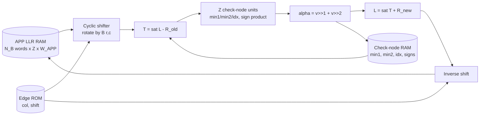

# Block: LDPC Syndrome Decoder

| Version | 0.2 (micro-architecture), 12 Oct 2026 |
|---|---|
| Milestone | M4 |
| Implements | [05-algorithm-spec §3.3–3.6](../05-algorithm-spec.md#3-reconciliation) |
| Oracle | `model/fixed.py` (L2), accelerated by `model/fast.py` — bit-exact |
| Build procedure | [stages/00-overview](../stages/00-overview.md) and the per-stage documents |

---

## 1. Function

Decode one frame: given Bob's received key bits, Alice's syndrome and a rate mask, produce Bob's corrected key bits, the iteration count and a success flag. Layered normalized min-sum, syndrome-aware, with early termination at iteration boundaries.

## 2. Ports

| Port | Dir | Width | Description |
|---|---|---|---|
| `clk`, `rst_n` | in | 1 | Clock, synchronous active-low reset |
| `s_axis_tdata/tvalid/tready/tlast` | in | 64 | Frame input: header, `y`, syndrome |
| `m_axis_tdata/tvalid/tready/tlast` | out | 64 | Decoded key bits |
| `cfg_mask_id` | in | 8 | Rate mask selector |
| `cfg_amplitude` | in | `W_CH` | Channel LLR magnitude `A` ([spec §3.4](../05-algorithm-spec.md#34-channel-llr-quantisation)) |
| `cfg_max_iters` | in | 6 | Iteration limit |
| `stat_ok` | out | 1 | Syndrome satisfied |
| `stat_iters` | out | 6 | Iterations used |
| `stat_busy` | out | 1 | Frame in progress |

## 3. Datapath



Per layer, for each non-zero base entry in increasing-column order:

1. Read the `Z` APP values of that base column (one wide memory word).
2. Rotate by the circulant shift so lane `i` lines up with check `rZ + i`.
3. Subtract the stored check message: `T = sat_APP(L − R_old)`.
4. Feed `|T|` (clipped to `W_MSG`) into the CNU's running minimum, and XOR the sign into the running sign product.
5. After the last entry of the row, the CNU holds min1, min2, idx and the sign; a second pass computes `R_new`, adds it to `T`, rotates back and writes the APP memory.

## 4. Memories

With `Z = 128`, `n_b = 512`, `W_APP = 8`, `W_MSG = 6` ([spec §2.1](../05-algorithm-spec.md#21-fixed-point-parameters)):

| Memory | Geometry | Bits | Notes |
|---|---|---|---|
| APP LLR | 512 words × (128 × 8) | 512 Kb | One word per base column; 1,024 bits read and written per cycle → about 15 BRAM36 side by side (72-bit wide, 512 deep) |
| Check-node state | `m_b × Z` entries × (2 × 6 + 4 index + `d_c` signs) | depends on `m_b` | Compressed form rebuilds every `R_ij` exactly ([learning guide §16.4](../00-learning-guide.md#164-compressed-check-node-storage)) |
| Edge ROM | `N_EDGES` × (`COL_BITS` + `SHIFT_BITS`) | ~2k × 16 b = 32 Kb | Generated by `scripts/export_code_mem.py` |
| Layer pointers | `m_b + 1` × 16 b | < 4 Kb | |
| Frame buffers | `n` + `m` bits | 64 Kb + m | Input `y` and syndrome |

The three M3 mother codes ([results/m3_code_design_v3](../../results/m3_code_design_v3/README.md)) all share `n = 65,536`, `Z = 128`, `n_b = 512` and `N_EDGES = 2,048`, and differ only in the number of layers:

| Code | serves | `m_b` | syndrome bits | max row degree |
|---|---|---|---|---|
| `v3_mother_0_r850` | Q = 1–2% | 77 | 9,856 | **27** |
| `v3_mother_1_r700` | Q = 3–6% | 154 | 19,712 | 14 |
| `v3_mother_2_r400` | Q = 8% | 307 | 39,296 | 7 |

Size the CNU's serial minimum-finder for **27** neighbours, the widest row across the set, so one datapath serves all three codes. Check-node storage scales with `m_b`, so the low-rate code is the memory-sizing case: 307 × 128 = 39,296 checks.

**Inference rules** that matter here (they decide whether you get BRAM or LUT RAM):
- No reset on the memory array.
- Registered read; no read-modify-write in a single cycle.
- One write port and one read port per memory (simple dual port).

## 5. Check-node unit

Serial over the row's neighbours, one per cycle:

```
if |T| < min1:  min2 <= min1; min1 <= |T|; idx <= position
elif |T| < min2: min2 <= |T|
sign_product <= sign_product ^ sign(T)
```

Three details are **normative**, because the bit-exact comparison depends on them:
- the comparison is **strict** (`<`), so ties keep the *first* minimum in increasing-column order;
- `sign(0) = +1`;
- magnitudes are clipped to `W_MSG` **before** the comparison.

Outgoing magnitude is `min1` for every neighbour except the one at `idx`, which gets `min2`; the sign is the running product XOR the syndrome bit, times that neighbour's own sign.

## 6. Cyclic shifter

A barrel shifter of `Z` lanes × `W_APP` bits: 7 stages for `Z = 128`. It implements the circulant `P^k` of [spec §3.1](../05-algorithm-spec.md#31-code-representation-qc-ldpc). Pipeline freely — it is a pure permutation, so inserting registers cannot change results, only latency.

## 7. Control and hazards

States: `IDLE → LOAD → INIT_LLR → LAYER_READ → LAYER_WRITE → CHECK_SYNDROME → (next iteration | DONE)`.

**The hazard to design around:** if layer `r+1` reads a base column that layer `r` has not finished writing, it reads stale APP values and the result stops matching the model. Options, in order of preference:

1. Order the base matrix so consecutive layers share few columns (a code-design choice, made once).
2. Stall the pipeline for the few conflicting entries.
3. Forward the in-flight value.

Approximating here is not allowed: [spec §3.6](../05-algorithm-spec.md#36-decoding-layered-normalized-min-sum-l2-bit-true) defines the result as the serial one, so the hardware must reproduce it exactly.

## 8. Early termination

At each iteration boundary (never mid-iteration), take the hard decisions `x̂ = (L < 0)` and test `H x̂ = s`. Cheapest implementation: reuse the layer walk to accumulate per-check parity during the next read pass, so the test costs no extra memory traffic.

## 9. Rate masks

The mask sets the initial LLRs ([spec §3.3](../05-algorithm-spec.md#33-rate-adaptation-puncturing-and-shortening)): key positions `±A`, punctured `0`, shortened `+127`. Masks are whole base columns, so the mask is a 512-bit vector per type — small enough to hold in registers or a tiny ROM indexed by `cfg_mask_id`.

## 10. Throughput model

$$C_{iter} \approx E_b + m_b \cdot L_p, \qquad T = \frac{n \cdot F_{max}}{I_{avg} \cdot C_{iter}}$$

with `E_b` the number of base edges and `L_p` the pipeline depth per layer. For `E_b ≈ 2,000`, `m_b ≈ 195`, `L_p = 8`, 125 MHz and `I_avg = 20`: about 3,560 cycles per iteration, 71,200 cycles per frame, 570 µs, **≈ 115 Mbit/s**. Read/write phases and hazard stalls will cut this; the target is ≥ 50 Mbit/s (REQ-PERF-04).

## 11. Resource estimate

| Item | Estimate |
|---|---|
| CNU lanes | 128 × ~60 LUT ≈ 8k LUT |
| Cyclic shifter | 128 lanes × 8 bits × 7 stages ≈ 2–4k LUT |
| Control, masks, syndrome check | ~2k LUT |
| **Total logic** | 12–20k LUT (23–38% of `xc7z020`) |
| **Total memory** | 35–45 BRAM36 (25–32%) |

## 12. Verification hooks

Behind `` `ifdef SIMULATION ``: dump the APP array after each layer, and expose the CNU's min1/min2/idx. The model can produce the matching dump for any frame, which turns "the frame decodes wrongly" into "layer 3, lane 57 diverges".

## 13. Open decisions

- Parallelism `P`: `P = Z = 128` avoids splitting a circulant rotation. A smaller `P` halves the logic at the cost of throughput — worth measuring once the first version closes timing.
- Hazard strategy (§7): choose after seeing the final base matrices.
- Whether to share the APP memory with the privacy-amplification datapath between frames.
